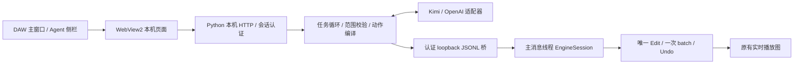
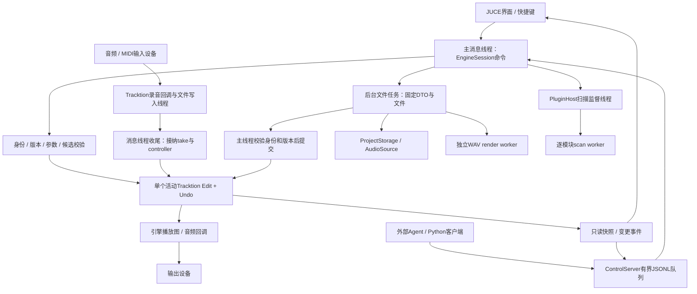

# E-musician 技术架构

## 0.13.2 插件诊断与Agent混音读取边界（2026-11-08）

原生插件仍在宿主进程内运行；扫描器和兼容探针在隔离子进程中逐项检查，外层Windows JobObject限制自有进程树寿命。扫描以顶层VST3 bundle为身份，递归遍历忽略包内支持DLL，避免误当VST2。元数据扫描、实例化、状态保存、离线DSP、真实设备初始化和GUI操作是不同证据；隔离扫描不等于实时插件已经沙箱化。隐藏peer探针不证明厂商原生编辑器已完成可见窗口attach。

Agent新增只读read_mix_context，在冻结的工程/选择修订下批量读取最多16轨、16个原生效果器，复用DawBridge的真实ID、归属及参数检查。公开快照保留已有路由、发送、自动化摘要和瞬时峰值，停止后衰减的峰值不能充当整曲响度。方案依旧经过本地校验、用户Apply、统一命令提交、回读与整批Undo；没有第二份音乐权威状态。完整听辨、整曲RMS/LUFS和参考曲匹配尚未实现。

OpenAI推理调用默认等待120秒，保留用户模型/high/4096输出预算；显示等待秒数、轮次和具体错误码，不自动重试收费请求。诊断仅存模型、工具名、轮次、用量、时间和错误码，不持久化用户提示词或私有推理。上述工作均在非实时控制/助手进程，音频回调未增加任务。紧凑M/S/R按宽度分配文字边距，命令语义不变。

详见[模型清单](review/2026-11-08-plugin-agent-stability/MODEL-MAP.md)和[Agent评测与步骤](review/2026-11-08-plugin-agent-stability/agent/README.md)。

## 0.13.1 克隆重连与界面语言边界（2026-11-08）

云端计算协议和权威工程没有改变。`emusician-autodl` SSH别名改指新实例44800端口；本地Worker按任务创建SSH隧道，访问远程loopback18082的protocol 2服务。模型环境、清单和固定release复用克隆数据，缺失的系统FFmpeg补装；没有从E盘重传模型。VS Code远程窗口仅供开发管理，不是DAW运行依赖。服务恢复、七模型推理与人工听感分别取证，见[本轮结果](review/2026-11-08-cloud-reconnect-ui/RESULTS.md)。

原生主题由应用持有`WorkspaceLookAndFeel`，作为全局默认，同时被工作区及装置控件主题继承。未挂在目标组件树中的PopupMenu、异步AlertWindow以及CallOutBox因此使用同一套token。只改变绘制、间距和焦点表现；原Save/Discard/Cancel结果ID、异步保存和工程命令保持不变。主题在窗口和引擎清理后解除，不进入实时回调。第三方插件窗口和Windows文件选择器使用自身主题。

Agent网页每次请求携带`X-Agent-Language`；服务在任务开始时冻结回答语言并加入模型系统指令，响应时按当前UI语言投影系统文案。运行器文案带来源标记，动态计划摘要使用双语字符串；不翻译命令ID、路径、工程数据、用户轨名/歌词或模型已有内容。原始状态仍留在运行器，未知后端中文错误可显示简短英文并保留诊断，不通过删中文字符破坏用户数据。认证、作用范围、候选接受、原子应用和一次撤销路径保持原样。取舍见[ADR](decisions/2026-11-08-shared-popup-agent-locale.md)。

## 运维备份边界（2026-11-07）

本地 `backup_progress.py → backup_monitor.py` 是只读投影：小型进度/收据文件→后台读取线程→Tk 主线程，2 秒刷新；下载器独立运行。UI 不发 SSH、不读取归档、不管理下载进程，不接入 DAW/Agent/音频回调。下载百分比与分块校验、全量校验完成分开；无新权威状态。安装副本与启动入口见[进度窗口](review/2026-11-07-backup-monitor/RESULTS.md)。

新增独立`scripts/cloud/full_backup.py`与`pull_full_backup.py`：云端空闲调度锁下对两个SQLite做一致快照，归档模型/环境/部署/任务/结果及其Python解释器；本地四路有界SSH续传、分块SHA、流式tar成员核对。它不进入DAW、Agent或实时回调。AutoDL系统镜像与数据盘备份分离；凭据不随模型包迁移。

云端快照生成、E盘下载、完整性验证、异机恢复是四种独立状态。本轮前者与小型恢复资料验证已通过，全量下载仍后台进行；不把“已启动下载”声明为“全部可恢复”。接口/范围/恢复限制以[本轮档案](review/2026-11-07-full-cloud-backup/RESULTS.md)为准。旧backup_data.py只覆盖早期ACE范围，不用于本次全量备份。

## 0.13 统一计算管线（2026-11-07，七模型整链已验证，人工待验）

`GUI / Agent → EngineSession 公共命令 → 冻结来源与修订 → 本地 Worker 或 SSH 后的 protocol 2 任务服务 → 校验本地候选 → 明确接受 → Edit / Undo / 本地资产`。实时音频回调不调用网络、模型、文件解析或任务轮询。新服务和宿主的完整验收记录以[本轮档案](review/2026-11-07-hybrid-pipeline/PLAN.md)为准；下文旧“尚不接入”是历史基线。

云端服务在 `scripts/cloud/compute`，提供内容寻址 WAV、SQLite 幂等记录、单 GPU 调度及独立模型进程。模型部署目录与任务服务分离，固定版本文件在加载前验证；服务全生命周期持有旧 ACE service lock，防止两个调度器争用显存。取消、资源不足和服务退出只回收所拥有进程组。每任务释放的代价是冷启动加载时间；它不等于热模型缓存已实现。

本地 `compute_client.py` 负责有界传输和任务身份，`run_analysis.py` 负责选区冻结、下载校验及分析候选转换，`run_compute_generation.py` 复用生成候选边界。单独的 `compute-registry.json` 保存配置与能力快照，旧本地分析 registry 保持；每次开始重新检查远端能力。云端分析只接受已适配模型的真实参数，不能把 Basic Pitch 的阈值控件套在 TransKun 上。

MIDI 规范结果包含每乐器的 notes、controllers、program/channel；综合结果包含 chord_regions、beat_events、structure_regions。秒数相对上传片段，宿主按冻结的时间映射落轨，不根据猜测 BPM 自动量化。模型原始输出保持可追溯，候选裁边或默认力度必须注明。GUI 与 Agent 使用同一候选及轨数预算，最终保存仅依赖本地工程资产。取舍见[ADR](decisions/2026-11-07-unified-cloud-compute.md)，[真实验收](review/2026-11-07-hybrid-pipeline/RESULTS.md)。

新云端分析实际保存为schema8，保留控制事件、分析标记和仪器元信息；生成使用schema7来源，`completion.truncated`统一为bool/null，YuE2原abc/semantic分项保留于stages。Saved score从权威工程派生当前音符/和弦，拍点/结构读取已接受注释。`EMUSICIAN_AUDIO_CACHE_ROOT`配置MP3解码缓存，新入口指向E盘；旧缓存不迁移。短暂Windows进度文件占用只重试原子发布；有界网络重连复用任务ID，但跨应用自动恢复未实现。

## 云端模型库层（2026-11-06，六模型短推理已验，尚不接入 DAW）

`scripts/cloud/models/` 仅管理固定版本的上游源码、权重、独立环境与验证记录。云端 `manifests/model-library/<model>/deployment.json` 分别声明文件、环境、CPU 加载和 GPU 推理状态，汇总目录不自动激活任何 Provider。生成、分离、钢琴转录与综合谱面环境分开，目录与负责人见 [部署计划](review/2026-11-06-cloud-model-library/PLAN.md)。大型文件只留云端，本地仅纳管脚本和小型档案。

这是模型运行层，位于未来任务适配器之下；本轮不改 GUI/Agent 命令、工程 schema、音频回调或现有 ACE 网关。已实现的联动仍是本地 MIR 与云端 ACE，统一多模型 GPU 调度与本地/云端切换尚未接入。不得从模型库安装状态推断 DAW 具备对应能力。

YuE2、SCNet、TransKun、ChordMini、SheetSage2、MuScriptor各有独立环境及验证入口，六项真实短探针已通过。MuScriptor medium的固定权重与配套配置在云端，下载凭据隔离在私有HF_HOME；离线推理通过本地绝对路径加载，不读取凭据。云端HF503时使用官方HTTPS→本地有界RAM→SSH云盘的流式部署工具，仅是下载路径，不进入DAW音频回调。`library_status.py` 读取每模型清单，校验状态依赖，显式 `--write` 才原子更新汇总catalog，不读写DAW工程。GPU探针使用共享文件锁、ACE队列只读准入和运行监测；异常只回收各自创建的进程组。这是离线评测协调，不能当作生产调度器或任意并发保障。

后续接入应在模型库上方增加统一任务适配器，负责请求/取消/结果契约、模型资源调度和来源校验，再复用已有候选与明确接受路径。禁止把推理代码、网络传输或大文件处理引入实时音频回调。旧ACE的网关/队列和新模型库有清楚边界；未实现的共享调度不能靠多个CLI同时运行替代。

取舍及后续边界见[云端模型库 ADR](decisions/2026-11-06-cloud-model-library.md)。

## 0.12.1 分析故障边界与生成默认值

本地分析仍是 `GUI/Agent → 公共分析命令 → 文件工作线程 → 独立 Python Worker → 候选 → 明确接受`。Windows Worker 由私有 Job Object 拥有，在恢复运行前绑定，异常/取消仅回收自身进程树；启动及运行中的提交内存检查、Worker 音频缓冲预算与明确 OOM 终态共同防护。CUDA OOM 不再同进程隐式转 CPU。失败诊断保留在任务目录，UI 展示可滚动原因，不向工程提交伪结果。

生成快照增加来自工程的 `generation_defaults`，普通请求自动沿用 BPM/拍号/播放头，默认 20 秒；小节时长由确定性代码换算。LLM 选工具，适配器校验，候选导入仍需确认。当前生成走云端 ACE、本地 MIR 走本机；正在准备的云端 MIR 文件和环境不构成本地/云端自由切换。详见 [ADR](decisions/2026-11-06-analysis-process-resource-isolation.md) 与 [本轮结果](review/2026-11-06-generation-stability/RESULTS.md)。

## 0.12 生成管线（真实云端/原生/Agent整链已验证）

`GenerationPanel / Agent → EngineSession generation命令 → 后台Python helper → 受管SSH隧道 → loopback网关/SQLite/单GPU队列 → ACE → PCM16+SHA清单 → E盘候选 → 试听/明确接受 → 本地工程资产/一次Undo`。生成不假造源clip，不复用需要源音频的分析元数据；聊天模型只组织工具调用，音乐模型独立生成音频。所有网络、模型和文件校验都在后台，音频回调不参与。

网关用request_id和规范参数维持幂等，重连查询原任务。模型延迟加载并热复用；取消在安全检查点执行，原生任务终止与远端确认分开记录。服务器重启标记未完成任务interrupted，模型运行栈与本地DAW独立。当前只配置ACE文字/歌词生成，未提供远程音频上传或MIR替换。

本地先校验大小、SHA和实际音频格式，再发布不可变候选。接受时重新核验结果及工程版本，并复制到E盘session assets，控制线程一次提交新轨道和`EM_GENERATIONS`来源记录。含生成来源使用schema7；普通旧工程保留所需版本。保存包含本地音频，重开/导出不需要云服务；未接受候选文件保留，但此版不恢复其跨DAW会话UI列表。

实现/API与准确验收范围见 [ADR](decisions/2026-11-06-cloud-generation.md)、[计划](review/2026-11-06-cloud-generation/PLAN.md) 和 [云端契约](review/2026-11-06-cloud-generation/CLOUD-API.md)。下面的完整混合计算方案仍有未实施项，不能从生成管线推断远程MIR或YuE2已就绪。

## 后续扩展：本地＋远程计算边界（2026-11-06，ACE以外待做）

计划将分析/生成 Provider 放在统一后台任务适配层：GUI/Agent 共用命令 → 冻结来源/时基 → 本地或 SSH 隧道后的远程任务服务 → 下载校验候选 → 明确接受 → 现有 Edit/Undo/工程资产。云端单 GPU 重任务队列与分模型环境独立于实时回调；结果成为本地资产后不依赖服务器在线。远程任务历史用于重连查询，不是工程自动保存。

完整方案仍是后续设计；上方ACE分支已经实现，远程MIR、其他生成模型及跨实例恢复仍未验收。模型选择、输出契约、故障状态、缓存与部署验收集中于 [完整计划](review/2026-11-06-hybrid-ai/PLAN.md)；下方为既有版本。

## 0.11.0 品牌工作区、颜色与效果手势（自动验证通过，人工待验）

`UiDesign.h` 统一标签/数值、纸色面板与轨道色；`Branding.h` 使用编译内嵌的批准 Logo，启动动画只在正常窗口 UI 线程定时。`MainWorkspace.inc` 管理顶部 transport、搜索库、实际项目概览、可调整下栏与侧栏响应式布局；`WorkspaceBrowser` / `ProjectOverview` 只消费快照，概览图缓存到小尺寸图片，滚动时不重画全部 clip。

`set_track_colour` 是 GUI 和 Agent 共同的编辑入口，严格 hex / 空串恢复，存入 Edit 的 emColour 及 StoredTrack.colour，旧工程缺省空。纯颜色批次更新元数据形成一次 Undo，不重建音频图或音符数组。Arrangement、PianoRoll、Agent 将其投影为身份色，选区状态独立。

`EngineSessionEffectGestures.inc` 管理原生效果预览事务；begin/update 只改短期 DSP 预览，end 轻量提交权威参数和一次 Undo，cancel/冲突恢复已提交状态。可见效果面板读取有界 2048 点输出并在 UI 线程做 FFT，音频回调仅原子发布采样及平滑 DSP。详见 [ADR](decisions/2026-11-06-brand-colour-device-gestures.md) 与 [本轮计划](review/2026-11-06-workspace-brand/PLAN.md)。Sampler/Rack 换样、真实插件/ASIO 和听感验收不因界面升级而被推断通过。

## 0.10.0 节拍与固定比例 Warp（自动验证通过，人工待验）

`AnalysisPanel / Agent → start_analysis(kind=beats) → Beat This! 独立进程 → 拍点与速度候选 → apply_beat_analysis → beginAudioWarp → 后台原件校验/Signalsmith 渲染 → revision 校验 → Edit 一次提交`。普通 Source 设置也进入 `set_audio_warp`，与分析应用共享后台任务、Undo 和资产流程。GUI 不另存音乐状态；Agent 使用候选 ID 和数值回读，不直接生成或执行 DSP。

原件与渲染 PCM 分开保留。`AudioTimeMap` 定义 sourceOffset 为原件坐标，运行时 playbackOffset 为 sourceOffset/speedRatio；speedRatio=targetBPM/sourceBPM。工程存 schema 6（无 Warp/节拍信息仍使用既有 4/5）；播放、波形、裁剪、切分、分析和导出共享映射。跟随速度的音频变速先准备再一次提交，已有独立 MIDI/分离轨不擅自改写，关联和弦区间按源片段映射更新。

设置、跟随视图和保存路径选择是工作流组件，不改变音频线程职责。跟随偏好与工程分开持久化；保存窗口只提供目的路径，继续调用原异步保存；右键菜单复用命令与版本保护。详细取舍、线程与精确依赖见 [ADR](decisions/2026-11-05-fixed-tempo-warp.md)。固定比例不等于局部 Warp 或任意音频完全无损；测量和验收以本轮 RESULTS 为准。

## 0.9.1 可视分析、语言和模型配置

和弦轨是 `EM_CHORDS → revision 缓存的共享只读 ChordRegionSnapshot → ArrangementView` 投影，不是音频轨、不参与混音图。共用标尺、缩放、水平滚动；多个分析按 analysisId 切换，绘制用排序区间索引裁剪到可视范围。双击按稳定 region ID 打开 AnalysisPanel 的来源过滤分页，修改继续走 `edit_chord_region`，保存/Undo 仍由 Edit 负责。和弦选择是视图状态，Agent 可按来源读取/编辑，未把它冒充音频/MIDI 选轨上下文。

分析下栏直接画候选音符/和弦矩形；分轨 128 点幅度包络由 Worker 计算，原生 paint 不读盘。下栏不展示评分、设备、算法版本等报告，这些继续保留在结果和日志。用户明确 Add 后普通分轨/MIDI 轨或和弦轨才写入工程；同一来源重复分析保持独立。

六轨通过独立 `separate_6s` 注册与固定权重接入原任务管线；quality 使用更高重叠和两次移位平均，fast 保持默认。转录仍为同一 Basic Pitch ONNX，instrument 只选音域；已知 other 只有显式指定音高乐器才允许尝试，drums 仍拒绝。和弦可选 24 或 132 类 + N，自有确定性模板/Viterbi，不是爵士训练模型。发布候选时记录 Worker 规范化参数，GUI/Agent 四/六轨数量、音域、标签及保存校验一致。schema 保持 5；旧 0.9.0 无法解释新扩展标签时明确拒绝，不静默改名。

`UiLanguage.h` 管理 en/zh-CN 偏好和变更计数，Settings 持久化到本机用户目录。组件只翻译标记的静态文案，用户轨名、素材名、插件名与模型内容保持原文；语言切换不更改工程、设备或播放图。AgentSidebar 用 locale 和 WebView JS 切换语言，不重启 worker 或清空草稿。第三方插件自身语言及部分历史底层诊断不在翻译范围。

源码实现与验收分开：来源和实测见 [Worker 记录](review/2026-11-05-analysis-workspace/WORKER-NOTES.md)，本轮总体证据见 [RESULTS](review/2026-11-05-analysis-workspace/RESULTS.md)，取舍见 [ADR](decisions/2026-11-05-analysis-workspace-language.md)。不能从本段结构推断识别准确率或 ASIO 性能。

## 0.9.0 本地分析管线（已实现，硬件/听感待人工）

`AnalysisPanel / Agent tools → EngineSession 分析命令 → 文件线程 → 注册 Python worker → 不可变候选 → 后台哈希/DTO 校验 → 控制线程一次提交`。实时图仅播放已导入素材；模型推理完全独立。`AnalysisPreview` 用专用后台流读取候选，回调仅消费有界 PCM 环形缓冲。

权威状态仍在 Tracktion Edit；候选不是第二套可写工程。已接受来源/模型记录位于 `EM_ANALYSES`，可编辑和弦位于 `EM_CHORDS`，和新增轨道一起进入 Undo。保存含分析工程用 schema 5；普通工程仍为 4。部署与技术取舍见 [ADR](decisions/2026-11-05-local-audio-analysis.md)，测量/限制以本轮结果文件为准。

每次请求固定源采样区间、clip/asset/project ID、tempo 与时间线映射；原件和已解码 PCM 的路径供后台 worker 只读使用。保存成功后的归档引用由控制线程单独跟踪，不改 worker 输入，也不把相同内容的归档判成编辑。接受时后台再次校验原件、当前归档、PCM、结果及分轨 hash，控制线程复核 revision/映射后一次提交；`recordEdit(false)` 将引擎延后的片段属性纳入同一次 Undo。普通保存可与模型推理并行，接受导入仍与文件事务互斥。

每次只运行一个重分析任务，最多 600 秒；录音前需完成或取消分析。候选查询分页，任务保留有界，未接受候选不随工程恢复。取消只处理宿主拥有的进程；新试听会取消旧的文件校验任务。试听为当前设备的独立流，固定 -12 dB，通过约 512 KiB 的环形缓冲播放；不经过工程主轨效果，关闭面板/切换工程/开始时间线播放时停止。线程隔离不等同于已验证 ASIO 实时负载。

Agent 只负责理解指令、选择本地分析工具和展示结果；本地适配器等待任务，不为进度轮询反复调用聊天模型。导入用受控 `result_id` 和明确确认卡，不把大量音符塞入模型 JSON，也不放开原有 16 动作/2000 普通编辑预算。能力清单由宿主命令、适配器、模型就绪状态及当前选区共同决定。已接受的和弦标签也经统一命令编辑、保存与 Undo。

## 历史提案：音频分析边界（2026-11-05，已由上节实现取代）

拟由 DAW 分析管理层拥有独立本机 worker，GUI 和 Agent 经同一命令启动任务、分页读取候选、确认后一次导入。分析进程独立于聊天 Provider，手动操作不要求 API；实时引擎继续不做推理。原生工程仍是唯一权威状态，音符/和弦/分离音频候选均不可直接写入。完整提案见 [分析方案](review/2026-11-05-audio-analysis/PLAN.md)，本节不代表当前已有 Provider 或新命令。

## 矩形编辑视图与装置图形控制（0.8.1，2026-11-05）

`PianoRoll` 的音符与 `ArrangementView` 的 clip 共用各自真实时域边界，绘制和命中区覆盖音高行/轨道行；矩形化不修改音符时长、起点或吸附结果。可视范围筛选和原有深缩放保留。

`DeviceControlStyle` 统一旋钮、带单位的数值输入、Shift 细调和默认值复位；`NativeEffectsGraph` 只从参数绘制有界曲线。拖动中保留面板本地预览，释放后经同一命令和版本检查一次提交；图形 Esc 取消。图示不另存一份工程，不在 paint 中读文件或调用模型。EQ 曲线使用 DSP 的同一系数；压缩器 GR 来自已有原子计量，其他响应/回声/衰减/调制图为参数示意。

EQ 每段增加滤波形状；Sampler/Rack 每个 pad 增加 `attack_ms`、`release_ms`、`one_shot`，贯通宿主范围校验、序列化、能力目录、Agent 方案编译和真实回读。新程序解释旧状态的默认值；改变原有默认形状/包络/模式时写装置状态版本 2，旧程序明确拒绝，避免忽略新参数后静默变声。工程 schema 和 catalog 协议版本保持原值。

Sampler/Rack 的纯参数任务在控制线程复制已发布 bank 的元数据，并共享不可变 PCM；worker 验证资产 ID/内容哈希后复用，显式换样本和工程重开仍走读取、哈希与解码。共享样本由控制线程保留，实时回调不接管销毁。**发布新 bank 仍会停止旧 voices**，参数连续自动化和无缝拓扑切换尚未实现。效果器和采样器 UI 不绕过版本、Undo 或保存规则。

接口见 [AGENT_API](AGENT_API.md)，本轮证据与范围见 [结果](review/2026-11-05-device-controls/RESULTS.md)。下方保留历史架构描述；其中“参数重解码”“Agent 未开放”等以本节及较新章节为准。

## 设备链与装置契约（2026-11-02）

`DeviceChainStrip` 只展示当前工程权威快照的轨道或主轨有序 slot；选择使用已有的原生面板或第三方编辑器路径，添加走 `EngineSession` 命令及既有版本/事务/异步策略。面板隐藏时使用低频检测恢复轮询，显式关闭后停止。第三方编辑器声库加载由插件自身负责，当前不能由宿主推断成功或失败。

效果器以版本化参数状态接入同一 slot 及保存/渲染链：压缩器 wet 路径传出原子 GR 计量，Delay/Reverb 缓冲按装置在非音频线程入图前准备，Auto Filter 使用固定状态；以上音频回调不执行文件或网络。Agent 在独立进程读取宿主能力目录，对照已实现类型、字段、范围、权限，生成可审阅方案并回读；不一致拒绝对应装置操作。注册表测试防止已登记类型的接口遗漏，但不会自动推导新 DSP 语义。真实设备、实时负载、第三方声库及完整合成器仍待验或未实现。[证据](review/2026-11-02-device-chain-agent/RESULTS.md)。

## 试听与原生效果器（2026-11-02，硬件待验）

波形面板在控制线程验证工程、版本、设备、鼓垫与 SHA 后，将已有不可变 PCM 交给有界后台 worker 计算概览；保留原始文件读取后备路径。设备载入时加快状态轮询，完成后降低频率。试听请求不写工程，独立渲染声音并送进原轨道效果与输出；声音是否可听仍受轨道静音、solo 和设备状态影响。

自有八段 EQ 和立体声峰值压缩器作为 `E-musician` effect slot，与 Sampler/Rack instrument 按 role 区分；底部面板及 Agent 共用命令/版本/撤销边界。参数控制在线程外校验并以有界快照发布，效果器音频处理不执行文件 I/O、网络或显式堆分配；重入时该块跳过效果处理，复杂图下尚无实时性能结论。读取单个效果器只取对应轨或主轨的设备状态，避免完整工程遍历。Agent 对效果器采用批量候选与回读；Sampler/Rack 参数目前仅支持工程范围单动作异步提交并等待终态，不允许任意本地文件路径。自动化参数、侧链和实时频谱尚未实现。

自动验证及限制见本轮 [结果](review/2026-11-02-audition-eq-compressor/RESULTS.md)，不能据此推断硬件或听感已验收。

## MIDI / 原生装置工作区（2026-11-02）

MIDI 展开保留同一 PianoRoll、选区及 Edit；NativeDevicePanel 在主窗口 dock 随所选轨更新，关闭时停止面板和波形轮询。`SampleWaveform` 使用串行后台 worker 为与已发布采样内容 SHA-256 一致的 WAV 快照生成有界峰值，编辑中仅本地预览、释放按 project/revision 走既有命令提交；paint/音频线程不读文件。`get_native_instrument` 在 ready 且非 pending 时提供各 pad 的 `sample_sha256`；波形不是第二份可写工程状态。缓存/队列均有界，慢盘及音频性能结论仍有边界。验证见[本轮记录](review/2026-11-02-device-redesign/RESULTS.md)。

## 原生采样器与鼓组候选（2026-11-02）

两类装置复用 `NativeSampler` 固定 voices/事件的播放核心、Tracktion `NativeInstrument` 插件封装及同一个权威 Edit；轨道设备状态是 schema 4 中版本化 `E-musician` slot，pads 用资产 ID 引用项目素材。控制层提交 native 命令，经有界后台 worker 解码不可变快照，验证项目、revision、设备、generation 和 token 后一次事务应用；UI 只读装置状态及提交命令。保存/导出使用已加载素材哈希验证实际归档文件，在 manifest 原子切换前拒绝不一致。详情、验证及限制见[本轮记录](review/2026-11-02-sampler-drum-rack/RESULTS.md)。

音频 callback 不做文件 I/O、JSON 解析或显式堆分配；发布的样本由控制线程保留和回收。不能把上述设计提升为完全硬实时保证：潜在并发回调会丢块并计数，故障磁盘同步读取不可中断，参数编辑仍会重解码并截断现有发声。真实设备、复杂路由与性能待验。Agent 模型工具没有开放新装置命令。

更新日期：2026-10-29（Asia/Shanghai）。当前开发为 DAW 0.8.0 / Agent 0.3 第二批，以下新增实现及自动验证已完成，实际桌面/设备听感仍待人工；已交付的0.7.0第一批证据保持原范围。最终状态见[CONTEXT](CONTEXT.md)，不能用旧硬件、插件或性能结果替代新版验收。

## Agent 0.3：依赖方案与任务边界

自动证据见[第二批验收](verification/2026-10-29-agent-batch2/RESULTS.md)。初始化及装载基线先创建宿主EM_PROJECT与引擎SCENES容器，再按Tracktion公开规则规范根节点顺序，之后清理历史；SCENES是内部容器，不代表新增场景启动功能。批次的原生延后属性更新仍归入同一事务，下一显式编辑正常分界；这样Undo/Redo不会被内部排序污染。音频回调不承担这些控制工作。

本批在既有侧栏/独立 worker 上扩展确定性编辑，不增加模型厂商。模型仍只调用 `read_clip_notes` 和 `propose_plan`；后者提出受限动作，由 Python 编译为原生命令。模型动作名称与原生协议不同，例如 `duplicate_clip` 编译为 `duplicate_clips`，音符新增/删除/移动/长度修改通过 `write_notes` 或 `edit_notes` 完成，不能据此认为原生接口新增了同名模型工具。

`plans.py` 在当前快照的临时候选上顺序模拟整个方案，计算新建对象、复制、位置、音符及最终预览。创建动作使用 `as` 声明类型化别名，后续动作以 `@alias` 引用；不猜测原生 UUID。`selection.py` 在模拟的每一步检查原选择及合法派生对象：选中音符不授权整片段编辑或无关新增音符，跨轨移动需要目标轨授权，时间范围约束新增/移动后的结果。候选仅用于审阅与校验，不能持续改写音乐；唯一权威工程仍是 EngineSession 中的 Edit。

原生 `batch` 在同一私有候选上顺序解析引用，保持既有逐命令校验，并在全部候选校验完成后才调用一次 live apply。引用只在 `track_id`、`target_track_id`、`clip_id`、`clip_ids[]` 这些明确位置解析；按轨/片段类型检查，不能前向引用、重用名称或跨批次使用。只有新建轨、新建 MIDI 片段及单片段复制可产生引用；轨道与片段实际 ID 始终由引擎生成。成功回执的 `refs` 和 `executed_commands` 只在提交完成后发布，失败不返回临时引用。

有效 batch 在提交边界结束先前 GUI 手势，随后形成独立一次 Undo；未通过候选校验的 batch 不结束或拆开现有手势。旧三参数 `EngineSession::execute` 调用保持兼容，可选结果输出参数供协议封装使用，不设置可被后续失败误读的全局“最近引用”。能力标记 `batch_result_refs=true`、`batch_result_refs_version=1` 让 Python 在写入前拒绝旧程序。

原生复制给片段、音符及控制器分配新 ID。Python 在复制 MIDI 后追加同批 `write_notes`，以本地生成的音符 UUID 建立确定的后续引用；原生 `write_notes/edit_notes` 保留控制器事件。Agent 对带控制器的 MIDI 裁剪明确拒绝，因为当前候选没有模拟原生边界控制器追踪；这不取消 DAW 原生 trim 的既有能力。单方案仍最多16项模型动作、2000次音符处理，每个待编辑片段需完整读取且最多2000音符；原生 batch 的100条命令与工程10万音符上限是另一层限制。

Runtime 的暂停只适用于规划：已发出的模型请求等待返回，在下一处控制边界暂停；不撤回请求或承诺免除费用。恢复后重读工程/选区，取消阻止后续请求和方案发布。请求派发、答案/方案发布与暂停/取消决策在同一锁边界衔接，等待不占据 HTTP 或音频线程。原子提交阶段不接受暂停/取消，成功后可按版本保护撤销整批；阶段进度不代表原生 batch 内逐条公开提交。

回执区分“未确认是否提交”与“已提交但回读失败”。提交超时/断流时停止不明写通道，不自动重发；已获成功回执时保留提交版本和相应 Undo 资格，回读失败不能描述为未执行。Undo 已获成功回执后立即消费该次撤销目标，即使随后的回读失败也不重复撤销。工程之后有手工修改时不撤销别人的工作。异步 GET 状态更新带任务 generation，旧查询不能覆盖已经开始的新任务、模型切换或取消后的状态。

网络和模型循环留在独立 Python worker；JSON 与命令在非实时控制线程处理，不进入音频回调。原生回读验证的是对象/音符/位置等数据，不能证明音色、听感或创作质量。完整协议见[AGENT_API](AGENT_API.md)，取舍见[ADR0011](decisions/0011-agent-atomic-dependent-plans.md)。本节描述源码实现；本批统一构建、原生/模型回归及人工验证尚未据此宣告通过。

## Agent 0.2：DAW 内嵌界面与独立 worker

`MainComponent` 显示可开关的 `AgentSidebar`，侧栏 WebView2 只载入本次会话受控的 loopback 页面。DAW 按需启动并拥有 Python 助手；隐藏侧栏保留草稿和正在执行的任务，暂停可见状态轮询。关闭/重启助手只清理所属 worker，不执行 DAW 的工程关闭逻辑。旧 stdio 伴随模式保留兼容，嵌入连接不沿用 EOF 导致 DAW 退出的所有权语义。新入口与旧入口不能混淆。

模型网络、JSON 解析及凭证存储留在 Python 非实时进程；原生桥通过有界请求队列进入主消息线程。网页不直接写 Edit；模型也不能调用任意 shell、文件、插件或设备接口。发布方案和应用前分别校验权威快照，应用仍是一次原子 batch，回读仅证明音乐状态符合预期，不证明听感或创作质量。

`EngineSessionSelection.inc` 持有可丢弃的只读选择投影：project_id/project_revision、selection_revision、活动轨/片段、track_ids/clip_ids、note_clip_id/note_ids、时间范围和最后音乐焦点。`MainComponent` 在控制请求执行前同步真实 UI 选择；`PianoRoll` 只导出稳定 ID，侧栏获得焦点不抹去音乐焦点。选择不修改音乐 revision、dirty 或 Undo。按音乐版本和音符快照身份失效的成员索引，避免每次轮询遍历大音符集合；使用预留容量的哈希集合查找音符ID，片段索引用位置而不跨快照保存原始指针。无音符选择不建立全音符索引，Agent从未打开时不做UI选择同步；超限选择明确标记 unavailable/truncated。

`selection.py` 冻结并检查操作范围：默认 selection，只对发送时选中的对象生效；project 必须由用户明确选择。底层另有 clip 范围接口，当前产品下拉框不展示。选中音符只授权这些 ID；时间范围以绝对秒的起音 `[start,end)` 过滤，量化也不能把起音移出范围。轨级操作、全局速度和新建对象有各自范围权限，不能靠模型提示词自行扩大。写命令带 expected_selection_revision，最终原生执行前再次拒绝过时选择。

`DawBridge.resolve_selection/resolve_clips` 对快照之外的明确目标分页读取并验证同一音乐版本；只补指定对象，不把摘要中的 64/256 片段上限当完整工程。待编辑 MIDI 片段必须完整读取且不超过 2000 音符，编译器另限制单方案 2000 次音符处理。不存在、过大或过期目标不进行部分修改。

`providers.py` 统一能力、配置和工厂；Kimi 使用聊天工具协议，OpenAI 使用 Responses，并仅在当前模型循环内部保留必要私有推理状态。schema2 偏好按 provider 存储 model/base_url，Windows DPAPI 凭证按 provider 隔离。Anthropic、Gemini、本地兼容服务明确 adapter_pending，不能调用。OpenAI 只接受受控官方端点；可沿用机器已有的 loopback 代理，代理不替换服务端点或 TLS 校验。无静默跨厂商回退、自动充值或无限付费重试。

开发与产品入口为 `scripts/dev_agent.py build/test/run`、`scripts/Start-Agent.ps1`；独立构建输出 build/sidebar。原生组件截图不含子 HWND 的真实网页像素，载入状态、合成网页视觉、实体 WebView 输入/听感分别验收。具体决策见[ADR0010](decisions/0010-embedded-agent-and-selection.md)。本节描述已实现边界，最终通过项以本批验证记录为准。

## 历史：Agent 0.1 非实时伴随进程

`scripts/music_agent`包含Provider/DPAPI、动作编译器、DawBridge、任务循环、HTTP及vanilla网页；Python标准库无运行时包依赖。网页只发送自然语言、plan ID和显式按钮操作。模型读取有界工程上下文/音符统计，提出结构化动作，本地校验器生成命令及可核查的前后预览。人工确认后一次batch进入原EngineSession，以原project_id/revision校验；回读验证与最近批次Undo同样受版本保护。

Provider、工具、权限与音乐引擎互相分离：网络不进入DAW进程，网页不直写Edit。JSONL断流/超时关闭写通道，不盲目重试；断线但子进程仍存活时不强制退出未保存工程。localhost服务有会话令牌/同源检查/有界线程，密钥仅DPAPI持久化。任务会话和方案是临时数据，审计只有受限元数据，不是第二份工程或恢复系统。

现阶段只支持确定性的基本编辑，不能听到音频、操作任意插件或后台自主生成素材；可扩展分析/生成worker和工具注册，但本轮不创建占位实现。架构取舍见[ADR0009](decisions/0009-kimi-agent-companion.md)。

## 0.6.1：编辑精度与绘制范围

`EditGrid.hpp`统一最细1/4096四分音符拍和三级标尺标签；绘制密度、标签密度、固定吸附精度分别计算，视图缩放不改变音乐数据。片段分割下界1µs，仍保持候选验证/命令/Undo边界。

Arrangement使用视口大小的Canvas与双精度时间原点；极长片段、选择区和ghost在时间域裁剪后再变为像素，避免巨型坐标和浮点抵消。网格按可见整数索引迭代，拖动开始建立边缘排序索引，移动时邻近查找。音频概要保持缓存；深度缩放单独串行worker读取最多65536帧的不可变细节窗，最多16个双通道窗约8MiB，代际校验阻止过时发布。paint线程不读音频文件。MIDI编曲概要仍为512列占用摘要，精确音符在PianoRoll编辑。

PianoRoll按音高和区间建立提交快照索引，可视查询复用它；拖动只更新选中项预览，提交再重建。密集预览绘制预算8192个音符，显示明确提示，点选和最终框选仍查询完整索引，不丢数据。取消或修订改变时保持原有回滚规则。

SMF导出4096PPQN匹配最细二进制网格；JUCE8内置writer的32位绝对tick不足48小时/300BPM，因此局部serializer保留64位绝对tick并使用4字节以内VLQ，长静默插入空文本meta事件。标准文件读取/严格校验和原有原子替换仍适用。非二进制自由位置和三连音按tick舍入；原生工程不做此量化。详见[ADR0008](decisions/0008-fine-grid-and-viewport-rendering.md)。

## 0.6.0：日常编辑与录音准备

标尺单位、Snap开关、网格精度和跟随属于界面状态，互相独立；`core/time/EditGrid.hpp`供编曲与钢琴卷帘共用，`MusicalPosition.hpp`定义音乐位置。引擎及SMF使用四分音符拍，显示和节拍器按拍号分母计拍；固定引擎的`lengthOfOneBeatDependsOnTimeSignature()`明确返回false，避免6/8等拍号下出现两套坐标。音乐位置每个显示拍960刻度，属性未修改时保留底层完整精度。

Arrangement提供框选、时间选区、批量跨兼容轨移动、循环拖柄/选区循环、播放跟随及音频淡化拖柄。手动滚动/编辑暂停自动跟随，重启播放后恢复。时间选区当前选中相交的完整片段。PianoRoll的画笔、独立Snap、音符剪贴板通过既有write_notes命令提交，不保存第二份可写序列。

片段剪贴板由EngineSession保留当前工程的不可变DTO与素材引用；cut验证成功才更新剪贴板，paste在候选中验证整组轨道兼容性和边界，分配新的片段/音符/controller ID，再按一次Undo应用。音频素材复用，Save As后按asset ID解析新的归档路径。纯MIDI组保留音乐间距，混合组保留绝对秒间距。新建/打开工程清空剪贴板。JSONL要求clipboard_id，复制重试遵守原有幂等响应，过时内容身份被拒绝。

RecordingController管理应用级click和count-in偏好；通过统一命令更改，不修改工程revision或dirty。从停止状态起录才执行预备拍，播放中Record仍是即时起录。倒数和录音边界由Tracktion原生时钟控制，UI只显示状态；停止预备拍直接取消。持续到首拍的音符及允许的独立控制器状态在原生录音边界收拢；原生依赖补丁由manifest哈希校验。细节与取舍见[ADR 0007](decisions/0007-daily-workflow-and-recording-clock.md)。

`EngineSessionTelemetry.inc`在控制线程读取原生LevelMeasurer：电平最高20Hz、RAM每秒一次，编辑内容快照仍沿既有缓存。监听绑定使用弱引用，Edit替换、轨道/输入消失及时清理。工作集含同进程插件，私有提交量另列；DSP百分比和xrun来自实际设备管理器，不冒充整机CPU或已听见的爆音。节拍器走设备cue，Master表包含cue，不写入内部输入录音和离线渲染。

自动smoke显式`--offline`，进程内所有嵌套引擎使用内存设备设置，避免测试访问真实声卡。保留物理播放检查的skipped状态，不能把合成时钟/渲染通过写成人工听感通过。

## 0.5.1候选：VST3通道缓冲边界

固定JUCE的宿主mapper在prepare阶段按最大块长为inactive输入/输出通道预分配独立float/double缓冲，process阶段清零复用；active通道仍映射到原宿主音频。bus数量、通道数和激活状态保持不变，闲置输出写入不混入主输出；过长块拒绝处理并清零，避免越界。该兼容补丁不提供插件多输出路由，也不隔离插件运行期崩溃；新增回归覆盖实际mapper，用户已确认当前Keyscape工程的MIDI编写/播放、实体键盘及Arm/Monitor正常，短录音已获用户确认；保存错误后来定位为音符时间边界，由0.5.2录音收尾修正，0.5.2真实录音保存、MIDI导出与重开回放现已获用户确认通过。实现与证据见[候选记录](verification/2026-10-27-v051/RESULTS.md)。

## 0.5.2：录音收尾与持久化模型边界

原生录音结束后，在同一Record take撤销事务内规范新捕获MIDI：有限非负短音符至少1/960拍，保留起音/ID/力度与全部事件，必要时延长片段尾部；处理非零起点的秒→拍精度。编辑快照、实际回放、Undo/Redo与保存共享修正后的同一Edit，不在保存副本偷偷修剪。收尾不立即切换Undo事务，空闲期的延迟native更新仍归于Record take；下一次明确编辑/手势/保存建立正常边界，保留延迟一次Undo断言及历史报告。MIDI导出将有效正时长的子刻度音符保留为至少一刻度，仍拒绝非法及溢出；存储严格校验保持。证据与适用边界见[0.5.2记录](verification/2026-10-27-v052/RESULTS.md)。

## 权威状态与产品边界

应用为 Windows x64 原生 DAW。C++20 承担工程控制，JUCE 承担界面、设备和平台设施，Tracktion Engine 承担 Edit、播放图、轨道、片段与渲染。活动音乐只有一个权威来源：`EngineSession` 拥有的 Tracktion Edit。保存、导入和命令校验使用临时 DTO；GUI、Agent 与后台任务不持有第二份可任意修改的音乐模型。

新工程默认120 BPM、4/4；音频按秒保存原速区间，MIDI 按拍保存位置和音符。速度范围20–300 BPM，暂不支持 TempoMap 或自动音频拉伸。不提供和弦工具、乐句模板或自有音源；MIDI 使用已安装的 Windows x64 VST2/VST3 乐器。

主编曲是持续可见的音频/MIDI 编辑中心；MIDI 编辑器、Source 源素材详情、Devices/I-O/Automation 使用同一窗口下方 Dock。真实分离及 Transcribe 分析尚未接入，不在常驻导航中展示。切换 Dock 延续同一工程、选择和 Transport，不创建另一个播放时钟。后续模型和 Agent UI 属于可选非实时层；本地播放编辑不依赖网络。

## 模块职责

| 位置 | 当前职责 |
|---|---|
| `apps/desktop/Main.cpp` | 应用、窗口生命周期；普通启动、stdio控制、扫描worker、渲染worker、smoke与性能探针入口 |
| `MainComponent.*` | 原生菜单、独立保存状态/请求合并、轨道混音/Inspector、单主编曲、下方Dock、全局录音控制和插件浏览器 |
| `AgentSidebar.*` | 可开关 WebView2 侧栏、本机会话/认证桥与所属 Python worker 生命周期；不拥有音乐工程 |
| `ArrangementView.*` | 唯一轨头与M/S/R/Devices、共轴音频/MIDI片段、选择/移动/裁剪手势、缩放滚动、后台波形峰值和MIDI概览 |
| `PianoRoll.*` | 音符绘制、移动、长度、力度、多选、量化、转调、复制/删除及16步鼓点；通过回调提交命令 |
| `SelectedTrackPanel.*` | 选轨/Master设备链、实际录音输入与逐轨 Monitor、Bus输出/发送、参数枚举和自动化曲线手势；只读快照与临时预览 |
| `EngineSession.cpp/.h` | Engine/Edit所有权、稳定ID绑定、快照、版本、事件、任务生命周期与控制线程约束 |
| `EngineSessionModel.inc` | 候选DTO到同一Edit的增量应用；ValueTree元数据和混音标量Undo |
| `EngineSessionCommands.inc` | 命令参数校验、候选变更、批次事务、普通编辑及Undo/Redo |
| `EngineSessionParameters.inc` | 插件参数分页读取及标量参数写入/Undo |
| `EngineSessionJobs.inc` | 后台导入/打开、分阶段插件状态采集与保存提交、SMF读写、WAV渲染子进程 |
| `EngineSessionPublic.inc` | UI兼容门面、快照、capabilities、JSONL请求和幂等响应 |
| `EngineSessionSelection.inc` | 可失效的 UI 选择投影、独立选择版本、稳定 ID 检查；不写音乐状态 |
| `EngineSessionProduction.h` | 生产图与录音控制器的消息线程契约，不是第二个Edit |
| `EngineSessionAutomationRouting.inc` | Bus/输出/发送的DAG校验及应用、自动化参数绑定/曲线、MIDI controller捕获/恢复与Undo |
| `EngineSessionRecording.inc` | 实际设备枚举/配置、输入绑定与逐轨监听、旧设备级命令兼容、Arm、线性take生命周期及录音结果接纳 |
| `EngineSessionTelemetry.inc` | 控制线程低频RAM/电平采集、监听生命周期、峰值重置；不修改音乐状态 |
| `AudioSource.*` | WAV检查，MP3完整帧扫描、顺序解码、内容寻址PCM缓存、取消与进度 |
| `ProjectStorage.*` | schema4校验、旧版迁移备份、未变媒体复用、新媒体归档、插件状态二进制、清单替换；不修改活动Edit |
| `PluginHost.*` | 插件目录、隔离扫描、实例化、原生窗口、状态保存/恢复、参数变化监听 |
| `ControlServer.*` | 有界JSONL读取/响应线程、消息线程分发、EOF/慢读/异常关闭 |
| `core/time/Time.hpp` | 固定速度的拍/秒/采样转换和边界检查 |
| `core/time/EditGrid.hpp`、`MusicalPosition.hpp` | 共享固定/自适应吸附、拍号显示坐标和严格音乐位置输入 |
| `core/commands/RevisionGuard.hpp` | 工程身份和版本契约；应用级幂等响应账本在EngineSession |
| `scripts/agent_client.py` | 专用控制进程的Python客户端与实际命令演示，无模型依赖 |
| `scripts/music_agent/` | 非实时任务循环、范围/动作校验、多供应商适配、DPAPI、嵌入/兼容桥、HTTP及网页；权威音乐仍在 Edit |
| `scripts/dev_agent.py` | 独立 build/sidebar 的构建、测试和原生 --agent 启动，复用 Recorder |
| `tests/`、`scripts/dev.py` | 引擎/存储/UI/后台任务回归；构建、运行、原始日志与源码指纹 |

`.inc` 是同一翻译单元的实现分片，不是独立可写工程层。源码、测试与精确依赖由版本管理维护；`_deps/`、`build/`、`build-logs/`、缓存和用户工程不作为源码提交。

交互引擎持久化自己的声卡设置；`EngineSession(false)`用于离线渲染与合成输入测试，注入独立内存`PropertyStorage`，每实例使用独立临时缓存目录。它既不读取也不写回用户`Settings.xml`，避免Hosted测试或后台渲染把真实ASIO配置覆盖。插件目录缓存仍由`PluginHost`的明确路径管理，插件身份校验与此设置隔离无关。设置窗口使用受控表单，Apply统一调用`configure_audio_device`并回读真实结果。

## 控制、播放与文件路径

| 执行环境 | 工作 | 不得跨越的边界 |
|---|---|---|
| 主消息线程 | UI、串行工程命令、Undo、插件实例和窗口操作、提交已准备结果 | 不让后台线程抢写Edit；大文件读取/复制/解码由worker准备 |
| 引擎音频线程 | 播放图、DSP、音符调度、设备输出 | 应用不在回调中执行JSON、文件操作、网络、模型推理或控制队列等待 |
| 引擎录音回调/写入线程 | 音频输入、MIDI事件和录音写入 | 应用不替换为UI线程写WAV；take完成后回消息线程接纳素材/片段并发布一次revision |
| 单个重文件worker | 哈希、解码、素材归档、工程读写、SMF及渲染监督 | 只拥有DTO和文件；不读取变化中的活动Edit |
| 波形worker | 从WAV/准备PCM生成峰值 | 绘制复用已准备峰值，不重新解析MP3 |
| 插件扫描worker进程 | 加载一个指定模块，报告有界插件描述 | 崩溃/超时不回退主进程扫描 |
| WAV渲染worker进程 | 恢复固定工程快照并渲染临时WAV | 不打开音频设备，不覆盖活动Edit；父进程决定最终替换 |
| stdio读写线程 | 有界输入及输出，承受慢读阻塞 | JSON请求执行仍回主线程；stdout只承载协议 |

线程分离不等于所有操作都无停顿。构建Edit、实例化第三方插件、获取原生状态仍须遵守宿主的主线程契约；其耗时和播放影响需要单独测量。

## 编辑、Undo与dirty

普通命令先从Edit读取临时候选DTO，校验ID、类型、范围及项目限制，再按稳定ID增量更新Track/Clip/Note。混音、循环等标量操作只校验和更新元数据，避免扫描全部音符；音符命令校验输入增量和全局ID/通道/总数约束。大量音符在脱离活动树时整批构建，再替换该片段的序列，避免引擎逐项插入的平方级查找。音频/MIDI片段和无关插件实例保持；新建/打开才切换整个Edit。批次先验证全部子命令，再作为一次事务应用；非有限值、失效对象和过期版本明确拒绝。

工程自有ID、音频引用、MIDI类型及插件槽元数据进入同一个ValueTree事务。固定Tracktion版本的参数和Transport setter不会自动提供可靠的Undo，因此轨道/主输出增益、声像、loop及外部插件参数由明确的标量`UndoableAction`记录前后值，执行时按稳定ID重新找目标。手势合并为一步；避免长期保留裸插件参数指针或整套工程快照。

普通编辑与对应Undo不主动停止播放。新增/删除/重排插件、工程和设备切换属于可明确停播的结构操作；插件拓扑判断覆盖batch。删除插件或带插件的轨道前，将当前原生状态写入被删除ValueTree的非Undo缓存，Undo即使在插件缓存回收后也能重建音色；不靠保活已删除插件占住样本内存。

Undo保存在当前进程，工程重开不恢复历史。当前UndoManager按存储单位控制容量；`setMaxNumberOfStoredUnits(1000000,64)`中的64是最少保留事务数，不是最多64步。dirty使用音乐内容摘要和插件变化标记，时间按纳秒、增益按0.001 dB规范化；保存期间的新修改不会被迟到保存清除。

## 快照与视图

结构快照按工程revision刷新；30Hz读取播放位置、设备状态和任务进度。每个MIDI片段的音符向量与内容摘要是只读派生缓存，由对应NOTE/SEQUENCE的ValueTree变化失效，Undo同样生效。播放头或无关混音更新复用共享向量，钢琴卷帘也复用同一身份；小批UI编辑走edit_notes。

非结构的小编辑（音高、力度、长度）复用原有精确二进制编码和每音符28字节偏移，以写时复制更新变化项后计算同格式摘要，避免重读全部原生属性并重新序列化。起点、通道、插入/删除及外部原生改动会使缓存整体失效；旧快照保持不可变，稳定ID、排序、Undo和持久化摘要格式不变。10万音符最多额外约7MB缓存，拷贝/摘要仍有随音符数增长的工作；具体测量见本轮报告，不能称为所有编辑恒定耗时。

ArrangementView只绘制可见轨道和片段，轨头控件按稳定ID绑定；主窗口不再刷新重复的左侧轨道列表。音频使用后台峰值和64项`AudioThumbnailCache`，原始路径/大小/修改时间组成显示缓存指纹。Source Dock复用同一准备源。MIDI概览缓存有限列数，不在每次播放头刷新中遍历全部音符。PianoRoll的坐标、力度与音符共享拍轴，首次按实际音高适配；16步鼓点直接改写同一MIDI音符模型。小高度以紧凑轨头保留至少两条编曲行，鼓机与钢琴网格避免叠压。

SelectedTrackPanel读取同一Snapshot中的输入、输出、Send、PluginSlot和AutomationLane。自动化点为共享只读向量；只有拖动期间复制当前lane的临时预览，释放后提交一次revision受检命令。曲线使用固定Tracktion版本的贝塞尔控制点/端点规则显示；参数纵轴归一化，当前值附参数单位文字。轨道gain/pan Inspector显示缓存的编辑基值，不承诺实时追随播放中的自动化值。I/O只查询现有输入列表，显式设备扫描不放进30Hz定时器；下拉展开时暂停列表刷新。

缩放、滚动、选择、焦点和播放头定位属于视图/运行状态，不产生音乐Undo。拖动中是局部预览，释放按起始revision提交；Escape取消，冲突后回读权威状态。窗口大小、DPI和物理键盘行为仍以实际验证为准。

## 音频与MIDI语义

WAV使用原PCM文件。MP3先计算内容哈希、扫描完整MPEG Layer III帧获得长度，再顺序解码为24-bit PCM WAV。播放和波形使用同一PCM，工程归档原始MP3。缓存位于`%APPDATA%\E-musician\cache\audio-v1`，没有自动GC；编码器delay/padding暂不裁除，不承诺gapless。free-format及流内版本/采样率/声道切换会拒绝；单个准备PCM受约4GiB RIFF大小限制。

音频片段记录源偏移、时间线起点、长度和线性淡入淡出，编辑不重写源。音频按秒保持原速；MIDI起点、长度和音符以四分音符拍表示。修改固定BPM后MIDI拍位不变，音频不自动拉伸。应用使用`ResamplingQuality::sincMedium`及显式维护的Tracktion分数源位置补丁，处理不同采样率下的块相位和seek偏移。补丁只修改固定版本的一个reader文件，bootstrap严格应用，CMake验证提交和文件哈希；算法与失败证据见[ADR0005](decisions/0005-daw-baseline-and-control.md)，实际音频回归仍以验证报告为准。

MIDI支持SMF0/1与PPQN，按源轨/通道分轨，导出960PPQN。导入检查完整事件边界，不以容错解析静默丢失截断事件。默认拒绝CC、程序切换、表达、速度/拍号图及SMPTE等无法保留的数据；显式`notes_only`才按现有速度只导音符。空工程可采用文件固定BPM/拍号，非空工程要求匹配。一个MIDI片段的音符使用相同通道；空片段添加鼓点默认通道10，已有音符则保留片段通道。

schema4额外保存引擎中已经存在或录到的MIDI controller事件：稳定ID、片段相对拍位、事件type、14-bit value与metadata。捕获/应用使用原序列事件和显式Undo动作，普通音符编辑不清空controller。SMF导出为支持的controller、pitch/pressure/program事件生成实际消息。这个保存/重开与导出路径不改变上段SMF导入的严格策略，也不代表已有完整CC曲线编辑器。

## 录音与生产信号图

`RecordingController`附着在当前Edit，使用Tracktion设备实例、录音回调和音频写入线程。持久化的是选定输入ID；Arm、正在录音/收尾和逐轨 Monitor 属于运行状态。输入选择按音频/MIDI类型校验；同一输入可绑定多轨，每轨可以独立选 off/auto/on。固定版本 Tracktion 的 `InputDeviceInstance::isLivePlayEnabled` 通过本仓库严格校验的补丁读取轨道运行态，录音 arm 和采集继续使用原引擎目标，避免把监听误当录音准备；旧设备级命令仍可统一设置该设备当前绑定轨。选新输入时控制线程尝试重绑，不在音频回调中更改设备。项目重开时监听复位 off，设备实例可能在驱动切换时销毁，绑定逻辑不跨设备重配置保留裸指针。

该补丁使用 `.cache/monitor-engine` 独立的固定版本 Tracktion/JUCE checkout；`python scripts/dev.py bootstrap` 准备、应用补丁，CMake 校验版本及补丁哈希，避免改动共享 `_deps` checkout。当前离线测试覆盖共享输入的逐轨模式、arm、录音、输入重绑，以及不更改 revision/Undo；真实声卡、键盘和插件听感未通过此测试验证。按住 MIDI 键时关闭监听是否会遗留长音尚待专项验证和处理；不能通过对轨道发送全局 all-notes-off 冒充精准释放，因为那会影响同轨的片段音符。

开始录音前检查实际设备、输入绑定、预备轨道、活动文件任务和loop；本轮只做线性take，开启loop时拒绝并提示关闭。停止并不等于收尾结束：录音文件完成后接纳片段、补稳定ID/素材绑定、恢复准备源，再形成一个可撤销的take事务和新的revision。录音/finalizing期间暂时拒绝工程编辑和保存，Stop保持可调用；未录入前不创建虚假音符或完成状态。音频/MIDI/ASIO真机验收必须单列，hosted buffer测试不能代替硬件链路。

设备API区分现有设备快照与显式扫描，配置涵盖driver type、设备名、采样率、buffer和活动输入通道；输出通道使用设备默认设置，`output_channels`只用于回读，尚不接受配置。失败尝试恢复原配置。ASIO依赖实际安装驱动和当前构建支持；源码存在入口不证明特定声卡低延迟或稳定性。UI使用受控表单，Apply统一调用`configure_audio_device`并回读实际结果；音频/MIDI输入在轨道I/O面板选择，再通过Arm预备录音。

生产图仍以Edit为权威，临时DTO只用于候选校验/序列化。Audio/Instrument/Bus通过`outputTargetId`到Master或Bus，Send包含目标Bus、增益、前/后推子和enabled。验证每个目标存在、禁止自指与有向环，批次经完整校验后应用引擎输出和aux发送/返回；不把绘制连线当成音频路由已生效。本轮没有任意VST多输出/侧链矩阵。

AutomationLane以稳定lane ID和目标类型绑定轨道增益/声像、Master增益或稳定plugin/parameter ID；点包含稳定ID、秒时间、归一化值和曲率，lane可旁路。非插件目标不携带plugin/parameter ID。引擎曲线管理实际播放与渲染，缺失插件保留未绑定数据。手工曲线编辑/Read播放属于当前范围，Touch/Latch/Write和自动化实时录写另行实现。Graph和controller同时进入schema4保存、增量应用与Undo，不能各自维护另一个工程模型。

## 后台任务与导出

一次只允许一个重文件任务执行或等待主线程提交，避免并发解码/归档耗尽资源；任务可查询进度和取消。导入/打开携带启动时的工程ID与revision，晚到结果在主线程再次检查，冲突不覆盖当前工程。保存/导出捕获固定DTO；文件完成后保存只更新对应路径/已保存摘要，不清除之后的修改。

普通Save有独立UI状态与job ID；先显示Saving并合并重复请求，再受理引擎任务。引擎先处理点击前的插件通知，以固定实例与变化generation逐插件采集；每次准备步骤最多一个插件，状态块不塞进JSON。阶段为queued、capturing_plugins、writing_media、writing_manifest、committing和终态，记录采集总时长、最慢单插件、已写/复用字节数。变化中的实例/generation会使准备冲突，不混合多个时间点的插件状态。单个第三方插件getState仍是不可拆分的主线程调用；逐插件让步不是其最大卡顿已消除的证据。

媒体归档在worker完成：对同一资产ID的已归档文件校验可复用性，未变文件继续被新清单引用，新增/变化媒体才复制；提交前再检查被复用文件未变。内容摘要、哈希和清单序列化放在文件worker。成功提交更新保存摘要，并把仍对应原资产的逻辑source改为归档路径，保留已有播放clip/graph与准备PCM；不为保存重建活动Edit。保存期间的新修改继续dirty，UI至多排一次后续Save；失败可重试，旧busy错误不覆盖当前进度。最终候选的两条394秒音频＋Serum默认音色已完成8次播放中保存（93.36–170.83ms，实际ASIO48k/256，xrun增量0），并验证重开与保存期间编辑保护；具体样本见[报告](verification/2026-10-27-v05/34eb7d59-playback-save.json)，不推及所有插件负载。

WAV导出先把快照归档到任务专属目录，再启动`--render-worker`。worker恢复工程及插件状态，渲染指定区间和0–60秒固定尾音，输出44.1/48/88.2/96kHz、16/24/32bit立体声WAV；可选按实时速度渲染。父进程检查worker结果、格式/长度及原目标指纹，成功才替换最终文件；取消、崩溃、超时或外部改写目标都保留旧目标。MIDI导出同样使用临时文件和替换前检查。

`accepted`只表示已受理；任务`completed`表示文件和主线程元数据提交均完成。退出时先取消、等待worker结束、释放提交闭包，再销毁Edit，避免迟到回调和线程自等待。同步导入/保存兼容入口仅供受控旧测试，交互入口走后台任务。

## schema4工程与恢复边界

`.emproj`保存工程身份/revision、固定速度拍号、循环、混音、轨道及片段；schema4增加Bus、输入选择、输出/Send、AutomationLane/Point和MIDI controller。音频资产、音符、插件槽和新增音乐对象使用稳定ID。插件原生状态放在同名`.assets/<代次>/`的独立二进制文件，清单记录相对路径、长度和SHA-256，不把大状态块塞进JSON。

保存先完成新增素材/状态文件并确认复用资产未变，再替换清单。schema1/2/3打开只在内存迁移；覆盖前逐字节保留`.emproj.schemaN-<UUID>.bak`，恢复时复制回原清单名并保留对应`.assets`。坏清单、缺素材和失败准备不切换活动工程。输入限制为64轨、4096素材/片段、100000音符、256插件、48小时时间线；新增上限为每轨32/全工程512个Send、每轨256/全工程4096个AutomationLane、100000个自动化点、100000个controller事件。清单16MiB、单插件状态64MiB、总状态256MiB。这些是拒绝过大输入的界限，不是可流畅处理这些数量的承诺。

旧素材代次和迁移备份不自动删除；新清单可能继续引用旧代次中已验证的素材。移动工程须同时移动清单及完整同名`.assets`。成功保存会将匹配的逻辑资产引用转为归档路径，并保持准备PCM和播放图；不能只移动“最新代次”文件夹。事务保存、迁移备份和Undo不等于自动保存或完整崩溃恢复；这些能力需单独实现和验收。

## VST2/VST3宿主

PluginHost只使用已安装的64位模块，支持乐器、轨道效果及master效果；单乐器槽、单/双声道总线，复杂多输出和侧链另行排期。目录缓存位于`%APPDATA%\E-musician\plugins-v1`。常规扫描搜索默认/附加目录，控制API可设`include_default_paths=false`关闭默认路径，或以`modules`指定最多64个绝对模块路径。每个模块独立启动`--plugin-scan-worker`，设置30秒超时、结果上限、取消和失败记录。

实例化校验插件身份与布局，缺失/不可用插件保留原槽位和状态，界面显示missing；相关启用插件缺失时拒绝WAV导出。插件窗口按Tracktion窗口生命周期关闭；参数回调只标记变化，主线程合并发布revision。状态快照包含原生块和有界归一化参数，兼容停止播放时VST3控制器已更新、组件块尚未更新的情况；恢复原生块后同步参数，删除后Undo重建也遵守这一顺序。完整状态在保存、导出及必要结构边界获取，不在30Hz快照轮询中反复读取。

扫描和离线导出有进程边界，**正常播放中的插件仍在DAW进程内**。不能宣称运行期插件沙箱，也不能由一个插件测试通过推断所有VST2/VST3兼容。每个实测插件记录模块版本、格式、加载/发声/编辑器/参数/状态重开/Undo/导出结果。

Undo/Redo执行后，仅对已经离开插件链、仍由watcher临时持有的实例更新原生缓存和逻辑槽；普通音符/混音Undo不抓取大状态。缓存失败反向回滚历史操作，避免返回失败却留下未发布的工程变更。VST3原生状态恢复跳过独立program切换，以免延迟程序事件覆盖已恢复音色。参数快照按索引保存，因此保存版本非空且与扫描版本不符时拒绝恢复为实例，保留missing槽和原始blob；跨版本迁移尚未实现。

## Agent协议

`--control-stdio`显式开启本地控制，无网络监听。写请求要求`request_id/project_id/expected_revision`；UI和Agent共用操作语义。响应区分完成、受理、冲突、错误；同一进程的相同请求ID重试返回已存响应，不重复执行。外部幂等账本最多10000项，不承诺跨进程去重；内部revision推进不再积累随机请求ID账本。`edit_notes`按稳定ID局部upsert/delete，各数组最多10000项；全量`write_notes`允许100000音符，stdio仍受单帧限制，应对大集合使用局部编辑。

输入/输出JSONL各限1MiB；队列各32项，主线程每轮最多处理8项，解析深度最多32层。快照提供轨道和有界片段/目录预览，音符、片段、目录和参数单独分页。事件保留1024项，任务保留64项；游标过旧要求回读快照。慢读端阻塞独立写线程，不直接堵住主消息线程。协议细节和可运行客户端见 [AGENT_API](AGENT_API.md)。

后续分析或模型进程只能读取快照、生成候选并通过接受命令提交。Ableton Remote Scripts/M4L属于可选适配器；用户提供的社区资料用于组件、模式、监听和生命周期设计，不是本项目音频引擎或完整SDK。

## 验证与决策

构建、测试、程序启动、设备播放、人工听感和性能分别记录。B01探针记录真实回调统计、设备CPU、可见XRun、控制线程编辑耗时及内存趋势；缺少的P99.9或物理输入到绘制延迟明确标为未测，不用均值或定时器间隔替代。

所有实际构建/运行按开发日志入口记录源码首尾指纹，用户工程只验证独立副本。最新证据在 [CONTEXT](CONTEXT.md)，追加历史在 [DEVLOG](DEVLOG.md)。架构沿革见 [ADR0001](decisions/0001-native-engine-boundary.md)、[ADR0002](decisions/0002-audio-project-bundle.md)、[ADR0003](decisions/0003-arrangement-overview.md)、[ADR0004](decisions/0004-audio-clips-and-schema2.md) 及本轮 [ADR0005](decisions/0005-daw-baseline-and-control.md)。
