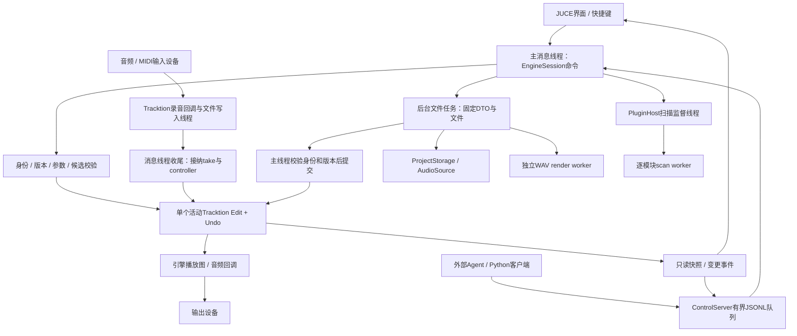

# E-musician 技术架构

更新日期：2026-10-27（Asia/Shanghai）。本文描述 0.5 当前实现及边界；保存管线、工作台、录音和生产图已通过最终候选双配置检查，具体原生操作、硬件及性能范围见 [CONTEXT](CONTEXT.md) 和 [本轮实测](verification/2026-10-27-v05/RESULTS.md)。历史 0.3/0.4 证据不替代新版本验收。

## 权威状态与产品边界

应用为 Windows x64 原生 DAW。C++20 承担工程控制，JUCE 承担界面、设备和平台设施，Tracktion Engine 承担 Edit、播放图、轨道、片段与渲染。活动音乐只有一个权威来源：`EngineSession` 拥有的 Tracktion Edit。保存、导入和命令校验使用临时 DTO；GUI、Agent 与后台任务不持有第二份可任意修改的音乐模型。

新工程默认120 BPM、4/4；音频按秒保存原速区间，MIDI 按拍保存位置和音符。速度范围20–300 BPM，暂不支持 TempoMap 或自动音频拉伸。不提供和弦工具、乐句模板或自有音源；MIDI 使用已安装的 Windows x64 VST2/VST3 乐器。

主编曲是持续可见的音频/MIDI 编辑中心；MIDI 编辑器、Source 源素材详情、Devices/I-O/Automation 使用同一窗口下方 Dock。真实分离及 Transcribe 分析尚未接入，不在常驻导航中展示。切换 Dock 延续同一工程、选择和 Transport，不创建另一个播放时钟。后续模型和 Agent UI 属于可选非实时层；本地播放编辑不依赖网络。

## 模块职责

| 位置 | 当前职责 |
|---|---|
| `apps/desktop/Main.cpp` | 应用、窗口生命周期；普通启动、stdio控制、扫描worker、渲染worker、smoke与性能探针入口 |
| `MainComponent.*` | 原生菜单、独立保存状态/请求合并、轨道混音/Inspector、单主编曲、下方Dock、全局录音控制和插件浏览器 |
| `ArrangementView.*` | 唯一轨头与M/S/R/Devices、共轴音频/MIDI片段、选择/移动/裁剪手势、缩放滚动、后台波形峰值和MIDI概览 |
| `PianoRoll.*` | 音符绘制、移动、长度、力度、多选、量化、转调、复制/删除及16步鼓点；通过回调提交命令 |
| `SelectedTrackPanel.*` | 选轨/Master设备链、实际录音输入与设备级Monitor、Bus输出/发送、参数枚举和自动化曲线手势；只读快照与临时预览 |
| `EngineSession.cpp/.h` | Engine/Edit所有权、稳定ID绑定、快照、版本、事件、任务生命周期与控制线程约束 |
| `EngineSessionModel.inc` | 候选DTO到同一Edit的增量应用；ValueTree元数据和混音标量Undo |
| `EngineSessionCommands.inc` | 命令参数校验、候选变更、批次事务、普通编辑及Undo/Redo |
| `EngineSessionParameters.inc` | 插件参数分页读取及标量参数写入/Undo |
| `EngineSessionJobs.inc` | 后台导入/打开、分阶段插件状态采集与保存提交、SMF读写、WAV渲染子进程 |
| `EngineSessionPublic.inc` | UI兼容门面、快照、capabilities、JSONL请求和幂等响应 |
| `EngineSessionProduction.h` | 生产图与录音控制器的消息线程契约，不是第二个Edit |
| `EngineSessionAutomationRouting.inc` | Bus/输出/发送的DAG校验及应用、自动化参数绑定/曲线、MIDI controller捕获/恢复与Undo |
| `EngineSessionRecording.inc` | 实际设备枚举/配置、输入绑定与设备级监听、Arm、线性take生命周期及录音结果接纳 |
| `AudioSource.*` | WAV检查，MP3完整帧扫描、顺序解码、内容寻址PCM缓存、取消与进度 |
| `ProjectStorage.*` | schema4校验、旧版迁移备份、未变媒体复用、新媒体归档、插件状态二进制、清单替换；不修改活动Edit |
| `PluginHost.*` | 插件目录、隔离扫描、实例化、原生窗口、状态保存/恢复、参数变化监听 |
| `ControlServer.*` | 有界JSONL读取/响应线程、消息线程分发、EOF/慢读/异常关闭 |
| `core/time/Time.hpp` | 固定速度的拍/秒/采样转换和边界检查 |
| `core/commands/RevisionGuard.hpp` | 工程身份和版本契约；应用级幂等响应账本在EngineSession |
| `scripts/agent_client.py` | 专用控制进程的Python客户端与实际命令演示，无模型依赖 |
| `tests/`、`scripts/dev.py` | 引擎/存储/UI/后台任务回归；构建、运行、原始日志与源码指纹 |

`.inc` 是同一翻译单元的实现分片，不是独立可写工程层。源码、测试与精确依赖由版本管理维护；`_deps/`、`build/`、`build-logs/`、缓存和用户工程不作为源码提交。

交互引擎持久化自己的声卡设置；`EngineSession(false)`用于离线渲染与合成输入测试，注入独立内存`PropertyStorage`，每实例使用独立临时缓存目录。它既不读取也不写回用户`Settings.xml`，避免Hosted测试或后台渲染把真实ASIO配置覆盖。插件目录缓存仍由`PluginHost`的明确路径管理，插件身份校验与此设置隔离无关。设置窗口使用受控表单，Apply统一调用`configure_audio_device`并回读真实结果。

## 控制、播放与文件路径

| 执行环境 | 工作 | 不得跨越的边界 |
|---|---|---|
| 主消息线程 | UI、串行工程命令、Undo、插件实例和窗口操作、提交已准备结果 | 不让后台线程抢写Edit；大文件读取/复制/解码由worker准备 |
| 引擎音频线程 | 播放图、DSP、音符调度、设备输出 | 应用不在回调中执行JSON、文件操作、网络、模型推理或控制队列等待 |
| 引擎录音回调/写入线程 | 音频输入、MIDI事件和录音写入 | 应用不替换为UI线程写WAV；take完成后回消息线程接纳素材/片段并发布一次revision |
| 单个重文件worker | 哈希、解码、素材归档、工程读写、SMF及渲染监督 | 只拥有DTO和文件；不读取变化中的活动Edit |
| 波形worker | 从WAV/准备PCM生成峰值 | 绘制复用已准备峰值，不重新解析MP3 |
| 插件扫描worker进程 | 加载一个指定模块，报告有界插件描述 | 崩溃/超时不回退主进程扫描 |
| WAV渲染worker进程 | 恢复固定工程快照并渲染临时WAV | 不打开音频设备，不覆盖活动Edit；父进程决定最终替换 |
| stdio读写线程 | 有界输入及输出，承受慢读阻塞 | JSON请求执行仍回主线程；stdout只承载协议 |

线程分离不等于所有操作都无停顿。构建Edit、实例化第三方插件、获取原生状态仍须遵守宿主的主线程契约；其耗时和播放影响需要单独测量。

## 编辑、Undo与dirty

普通命令先从Edit读取临时候选DTO，校验ID、类型、范围及项目限制，再按稳定ID增量更新Track/Clip/Note。混音、循环等标量操作只校验和更新元数据，避免扫描全部音符；音符命令校验输入增量和全局ID/通道/总数约束。大量音符在脱离活动树时整批构建，再替换该片段的序列，避免引擎逐项插入的平方级查找。音频/MIDI片段和无关插件实例保持；新建/打开才切换整个Edit。批次先验证全部子命令，再作为一次事务应用；非有限值、失效对象和过期版本明确拒绝。

工程自有ID、音频引用、MIDI类型及插件槽元数据进入同一个ValueTree事务。固定Tracktion版本的参数和Transport setter不会自动提供可靠的Undo，因此轨道/主输出增益、声像、loop及外部插件参数由明确的标量`UndoableAction`记录前后值，执行时按稳定ID重新找目标。手势合并为一步；避免长期保留裸插件参数指针或整套工程快照。

普通编辑与对应Undo不主动停止播放。新增/删除/重排插件、工程和设备切换属于可明确停播的结构操作；插件拓扑判断覆盖batch。删除插件或带插件的轨道前，将当前原生状态写入被删除ValueTree的非Undo缓存，Undo即使在插件缓存回收后也能重建音色；不靠保活已删除插件占住样本内存。

Undo保存在当前进程，工程重开不恢复历史。当前UndoManager按存储单位控制容量；`setMaxNumberOfStoredUnits(1000000,64)`中的64是最少保留事务数，不是最多64步。dirty使用音乐内容摘要和插件变化标记，时间按纳秒、增益按0.001 dB规范化；保存期间的新修改不会被迟到保存清除。

## 快照与视图

结构快照按工程revision刷新；30Hz读取播放位置、设备状态和任务进度。每个MIDI片段的音符向量与内容摘要是只读派生缓存，由对应NOTE/SEQUENCE的ValueTree变化失效，Undo同样生效。播放头或无关混音更新复用共享向量，钢琴卷帘也复用同一身份；小批UI编辑走edit_notes。

非结构的小编辑（音高、力度、长度）复用原有精确二进制编码和每音符28字节偏移，以写时复制更新变化项后计算同格式摘要，避免重读全部原生属性并重新序列化。起点、通道、插入/删除及外部原生改动会使缓存整体失效；旧快照保持不可变，稳定ID、排序、Undo和持久化摘要格式不变。10万音符最多额外约7MB缓存，拷贝/摘要仍有随音符数增长的工作；具体测量见本轮报告，不能称为所有编辑恒定耗时。

ArrangementView只绘制可见轨道和片段，轨头控件按稳定ID绑定；主窗口不再刷新重复的左侧轨道列表。音频使用后台峰值和64项`AudioThumbnailCache`，原始路径/大小/修改时间组成显示缓存指纹。Source Dock复用同一准备源。MIDI概览缓存有限列数，不在每次播放头刷新中遍历全部音符。PianoRoll的坐标、力度与音符共享拍轴，首次按实际音高适配；16步鼓点直接改写同一MIDI音符模型。小高度以紧凑轨头保留至少两条编曲行，鼓机与钢琴网格避免叠压。

SelectedTrackPanel读取同一Snapshot中的输入、输出、Send、PluginSlot和AutomationLane。自动化点为共享只读向量；只有拖动期间复制当前lane的临时预览，释放后提交一次revision受检命令。曲线使用固定Tracktion版本的贝塞尔控制点/端点规则显示；参数纵轴归一化，当前值附参数单位文字。轨道gain/pan Inspector显示缓存的编辑基值，不承诺实时追随播放中的自动化值。I/O只查询现有输入列表，显式设备扫描不放进30Hz定时器；下拉展开时暂停列表刷新。

缩放、滚动、选择、焦点和播放头定位属于视图/运行状态，不产生音乐Undo。拖动中是局部预览，释放按起始revision提交；Escape取消，冲突后回读权威状态。窗口大小、DPI和物理键盘行为仍以实际验证为准。

## 音频与MIDI语义

WAV使用原PCM文件。MP3先计算内容哈希、扫描完整MPEG Layer III帧获得长度，再顺序解码为24-bit PCM WAV。播放和波形使用同一PCM，工程归档原始MP3。缓存位于`%APPDATA%\E-musician\cache\audio-v1`，没有自动GC；编码器delay/padding暂不裁除，不承诺gapless。free-format及流内版本/采样率/声道切换会拒绝；单个准备PCM受约4GiB RIFF大小限制。

音频片段记录源偏移、时间线起点、长度和线性淡入淡出，编辑不重写源。音频按秒保持原速；MIDI起点、长度和音符以四分音符拍表示。修改固定BPM后MIDI拍位不变，音频不自动拉伸。应用使用`ResamplingQuality::sincMedium`及显式维护的Tracktion分数源位置补丁，处理不同采样率下的块相位和seek偏移。补丁只修改固定版本的一个reader文件，bootstrap严格应用，CMake验证提交和文件哈希；算法与失败证据见[ADR0005](decisions/0005-daw-baseline-and-control.md)，实际音频回归仍以验证报告为准。

MIDI支持SMF0/1与PPQN，按源轨/通道分轨，导出960PPQN。导入检查完整事件边界，不以容错解析静默丢失截断事件。默认拒绝CC、程序切换、表达、速度/拍号图及SMPTE等无法保留的数据；显式`notes_only`才按现有速度只导音符。空工程可采用文件固定BPM/拍号，非空工程要求匹配。一个MIDI片段的音符使用相同通道；空片段添加鼓点默认通道10，已有音符则保留片段通道。

schema4额外保存引擎中已经存在或录到的MIDI controller事件：稳定ID、片段相对拍位、事件type、14-bit value与metadata。捕获/应用使用原序列事件和显式Undo动作，普通音符编辑不清空controller。SMF导出为支持的controller、pitch/pressure/program事件生成实际消息。这个保存/重开与导出路径不改变上段SMF导入的严格策略，也不代表已有完整CC曲线编辑器。

## 录音与生产信号图

`RecordingController`附着在当前Edit，使用Tracktion设备实例、录音回调和音频写入线程。持久化的是选定输入ID；Arm、正在录音/收尾和设备Monitor属于运行状态。输入选择按音频/MIDI类型校验；同一输入可绑定多轨，Monitor是输入设备级off/auto/on，不能伪装成独立逐轨监听。设备实例可能在驱动切换时销毁，绑定逻辑不跨设备重配置保留裸指针。

开始录音前检查实际设备、输入绑定、预备轨道、活动文件任务和loop；本轮只做线性take，开启loop时拒绝并提示关闭。停止并不等于收尾结束：录音文件完成后接纳片段、补稳定ID/素材绑定、恢复准备源，再形成一个可撤销的take事务和新的revision。录音/finalizing期间暂时拒绝工程编辑和保存，Stop保持可调用；未录入前不创建虚假音符或完成状态。音频/MIDI/ASIO真机验收必须单列，hosted buffer测试不能代替硬件链路。

设备API区分现有设备快照与显式扫描，配置涵盖driver type、设备名、采样率、buffer和活动输入通道；输出通道使用设备默认设置，`output_channels`只用于回读，尚不接受配置。失败尝试恢复原配置。ASIO依赖实际安装驱动和当前构建支持；源码存在入口不证明特定声卡低延迟或稳定性。UI使用受控表单，Apply统一调用`configure_audio_device`并回读实际结果；音频/MIDI输入在轨道I/O面板选择，再通过Arm预备录音。

生产图仍以Edit为权威，临时DTO只用于候选校验/序列化。Audio/Instrument/Bus通过`outputTargetId`到Master或Bus，Send包含目标Bus、增益、前/后推子和enabled。验证每个目标存在、禁止自指与有向环，批次经完整校验后应用引擎输出和aux发送/返回；不把绘制连线当成音频路由已生效。本轮没有任意VST多输出/侧链矩阵。

AutomationLane以稳定lane ID和目标类型绑定轨道增益/声像、Master增益或稳定plugin/parameter ID；点包含稳定ID、秒时间、归一化值和曲率，lane可旁路。非插件目标不携带plugin/parameter ID。引擎曲线管理实际播放与渲染，缺失插件保留未绑定数据。手工曲线编辑/Read播放属于当前范围，Touch/Latch/Write和自动化实时录写另行实现。Graph和controller同时进入schema4保存、增量应用与Undo，不能各自维护另一个工程模型。

## 后台任务与导出

一次只允许一个重文件任务执行或等待主线程提交，避免并发解码/归档耗尽资源；任务可查询进度和取消。导入/打开携带启动时的工程ID与revision，晚到结果在主线程再次检查，冲突不覆盖当前工程。保存/导出捕获固定DTO；文件完成后保存只更新对应路径/已保存摘要，不清除之后的修改。

普通Save有独立UI状态与job ID；先显示Saving并合并重复请求，再受理引擎任务。引擎先处理点击前的插件通知，以固定实例与变化generation逐插件采集；每次准备步骤最多一个插件，状态块不塞进JSON。阶段为queued、capturing_plugins、writing_media、writing_manifest、committing和终态，记录采集总时长、最慢单插件、已写/复用字节数。变化中的实例/generation会使准备冲突，不混合多个时间点的插件状态。单个第三方插件getState仍是不可拆分的主线程调用；逐插件让步不是其最大卡顿已消除的证据。

媒体归档在worker完成：对同一资产ID的已归档文件校验可复用性，未变文件继续被新清单引用，新增/变化媒体才复制；提交前再检查被复用文件未变。内容摘要、哈希和清单序列化放在文件worker。成功提交更新保存摘要，并把仍对应原资产的逻辑source改为归档路径，保留已有播放clip/graph与准备PCM；不为保存重建活动Edit。保存期间的新修改继续dirty，UI至多排一次后续Save；失败可重试，旧busy错误不覆盖当前进度。最终候选的两条394秒音频＋Serum默认音色已完成8次播放中保存（93.36–170.83ms，实际ASIO48k/256，xrun增量0），并验证重开与保存期间编辑保护；具体样本见[报告](verification/2026-10-27-v05/34eb7d59-playback-save.json)，不推及所有插件负载。

WAV导出先把快照归档到任务专属目录，再启动`--render-worker`。worker恢复工程及插件状态，渲染指定区间和0–60秒固定尾音，输出44.1/48/88.2/96kHz、16/24/32bit立体声WAV；可选按实时速度渲染。父进程检查worker结果、格式/长度及原目标指纹，成功才替换最终文件；取消、崩溃、超时或外部改写目标都保留旧目标。MIDI导出同样使用临时文件和替换前检查。

`accepted`只表示已受理；任务`completed`表示文件和主线程元数据提交均完成。退出时先取消、等待worker结束、释放提交闭包，再销毁Edit，避免迟到回调和线程自等待。同步导入/保存兼容入口仅供受控旧测试，交互入口走后台任务。

## schema4工程与恢复边界

`.emproj`保存工程身份/revision、固定速度拍号、循环、混音、轨道及片段；schema4增加Bus、输入选择、输出/Send、AutomationLane/Point和MIDI controller。音频资产、音符、插件槽和新增音乐对象使用稳定ID。插件原生状态放在同名`.assets/<代次>/`的独立二进制文件，清单记录相对路径、长度和SHA-256，不把大状态块塞进JSON。

保存先完成新增素材/状态文件并确认复用资产未变，再替换清单。schema1/2/3打开只在内存迁移；覆盖前逐字节保留`.emproj.schemaN-<UUID>.bak`，恢复时复制回原清单名并保留对应`.assets`。坏清单、缺素材和失败准备不切换活动工程。输入限制为64轨、4096素材/片段、100000音符、256插件、48小时时间线；新增上限为每轨32/全工程512个Send、每轨256/全工程4096个AutomationLane、100000个自动化点、100000个controller事件。清单16MiB、单插件状态64MiB、总状态256MiB。这些是拒绝过大输入的界限，不是可流畅处理这些数量的承诺。

旧素材代次和迁移备份不自动删除；新清单可能继续引用旧代次中已验证的素材。移动工程须同时移动清单及完整同名`.assets`。成功保存会将匹配的逻辑资产引用转为归档路径，并保持准备PCM和播放图；不能只移动“最新代次”文件夹。事务保存、迁移备份和Undo不等于自动保存或完整崩溃恢复；这些能力需单独实现和验收。

## VST2/VST3宿主

PluginHost只使用已安装的64位模块，支持乐器、轨道效果及master效果；单乐器槽、单/双声道总线，复杂多输出和侧链另行排期。目录缓存位于`%APPDATA%\E-musician\plugins-v1`。常规扫描搜索默认/附加目录，控制API可设`include_default_paths=false`关闭默认路径，或以`modules`指定最多64个绝对模块路径。每个模块独立启动`--plugin-scan-worker`，设置30秒超时、结果上限、取消和失败记录。

实例化校验插件身份与布局，缺失/不可用插件保留原槽位和状态，界面显示missing；相关启用插件缺失时拒绝WAV导出。插件窗口按Tracktion窗口生命周期关闭；参数回调只标记变化，主线程合并发布revision。状态快照包含原生块和有界归一化参数，兼容停止播放时VST3控制器已更新、组件块尚未更新的情况；恢复原生块后同步参数，删除后Undo重建也遵守这一顺序。完整状态在保存、导出及必要结构边界获取，不在30Hz快照轮询中反复读取。

扫描和离线导出有进程边界，**正常播放中的插件仍在DAW进程内**。不能宣称运行期插件沙箱，也不能由一个插件测试通过推断所有VST2/VST3兼容。每个实测插件记录模块版本、格式、加载/发声/编辑器/参数/状态重开/Undo/导出结果。

Undo/Redo执行后，仅对已经离开插件链、仍由watcher临时持有的实例更新原生缓存和逻辑槽；普通音符/混音Undo不抓取大状态。缓存失败反向回滚历史操作，避免返回失败却留下未发布的工程变更。VST3原生状态恢复跳过独立program切换，以免延迟程序事件覆盖已恢复音色。参数快照按索引保存，因此保存版本非空且与扫描版本不符时拒绝恢复为实例，保留missing槽和原始blob；跨版本迁移尚未实现。

## Agent协议

`--control-stdio`显式开启本地控制，无网络监听。写请求要求`request_id/project_id/expected_revision`；UI和Agent共用操作语义。响应区分完成、受理、冲突、错误；同一进程的相同请求ID重试返回已存响应，不重复执行。外部幂等账本最多10000项，不承诺跨进程去重；内部revision推进不再积累随机请求ID账本。`edit_notes`按稳定ID局部upsert/delete，各数组最多10000项；全量`write_notes`允许100000音符，stdio仍受单帧限制，应对大集合使用局部编辑。

输入/输出JSONL各限1MiB；队列各32项，主线程每轮最多处理8项，解析深度最多32层。快照提供轨道和有界片段/目录预览，音符、片段、目录和参数单独分页。事件保留1024项，任务保留64项；游标过旧要求回读快照。慢读端阻塞独立写线程，不直接堵住主消息线程。协议细节和可运行客户端见 [AGENT_API](AGENT_API.md)。

后续分析或模型进程只能读取快照、生成候选并通过接受命令提交。Ableton Remote Scripts/M4L属于可选适配器；用户提供的社区资料用于组件、模式、监听和生命周期设计，不是本项目音频引擎或完整SDK。

## 验证与决策

构建、测试、程序启动、设备播放、人工听感和性能分别记录。B01探针记录真实回调统计、设备CPU、可见XRun、控制线程编辑耗时及内存趋势；缺少的P99.9或物理输入到绘制延迟明确标为未测，不用均值或定时器间隔替代。

所有实际构建/运行按开发日志入口记录源码首尾指纹，用户工程只验证独立副本。最新证据在 [CONTEXT](CONTEXT.md)，追加历史在 [DEVLOG](DEVLOG.md)。架构沿革见 [ADR0001](decisions/0001-native-engine-boundary.md)、[ADR0002](decisions/0002-audio-project-bundle.md)、[ADR0003](decisions/0003-arrangement-overview.md)、[ADR0004](decisions/0004-audio-clips-and-schema2.md) 及本轮 [ADR0005](decisions/0005-daw-baseline-and-control.md)。
