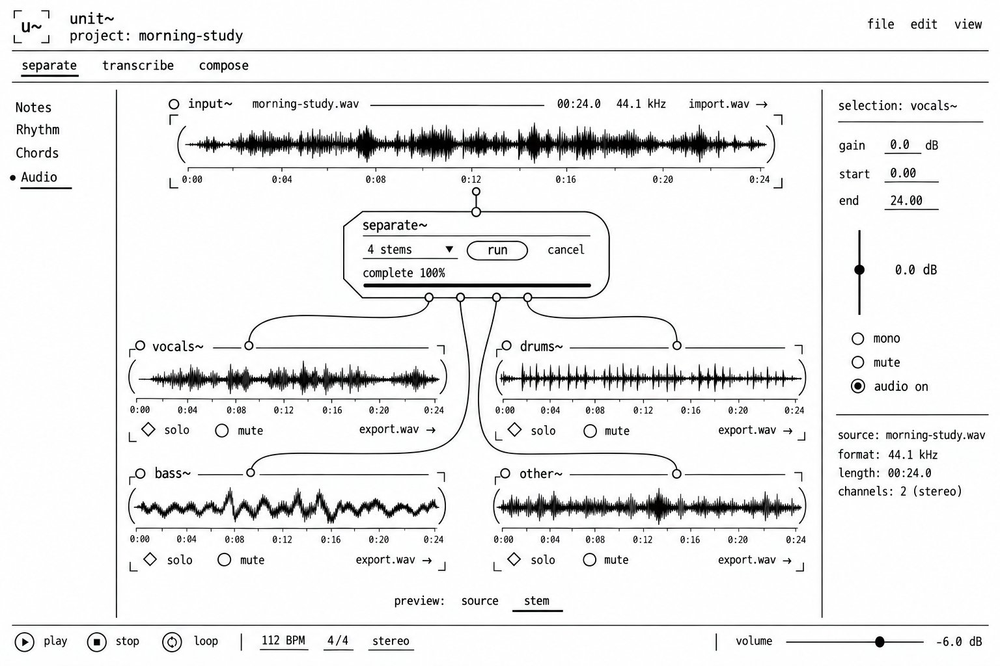
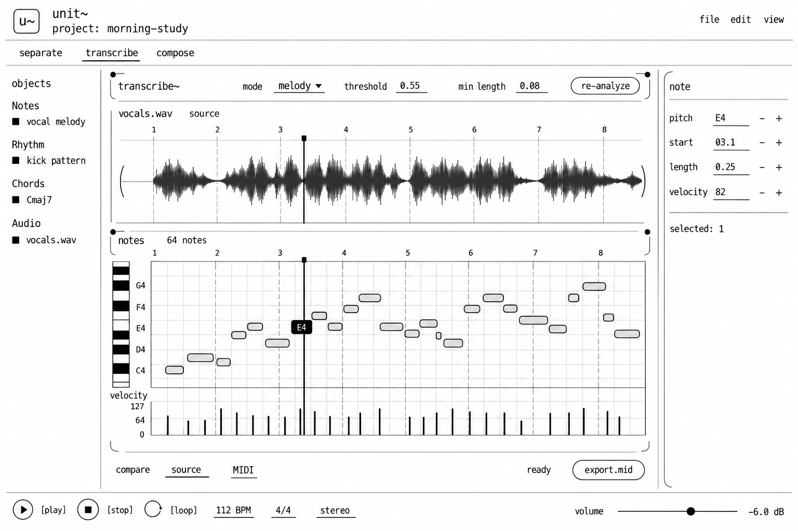
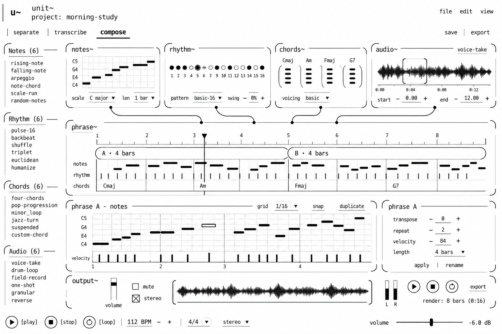

# UI 参考与交互规格

## 0.13.1 弹出组件与英文一致性

File/右键/子菜单、设备下拉、分析Options和保存确认复用根DESIGN的纸白、细线及青绿焦点色。菜单行高28px，命令名与快捷键分列；选项层保持原锚点，采用不透明纸白外壳。关闭保存框保留Save/Discard/Cancel、Esc取消和Tab顺序，使用32px按钮及浅色底栏，移除默认大问号和重阴影。系统文件选择器与外部插件不由本应用主题重绘。

English界面下Agent的系统进度、方案摘要、错误和回答要求使用英文；切换界面不会改写用户轨名、文件名、原输入或歌词。原生组件截图与实际模型回复分开验证；物理鼠标/DPI仍按[人工清单](review/2026-11-08-cloud-reconnect-ui/MODEL-TESTS.md)验收。

## 0.11.0 批准的品牌工作区（自动验证通过，人工待验）

以 [批准设计图](review/2026-11-06-workspace-brand/approved-workspace.png) 为构图依据，Logo 为 [用户原件](../assets/brand/yi-yue-shi-logo.png)，用于 Windows 图标、约 0.9 秒启动淡入淡出与左上角。详细 token 与状态原则统一在根 [DESIGN](../DESIGN.md)，不在多处维护不同标准。

播放/停止/录音/循环、位置与速度位于顶部；File 管理新建/打开/保存/导出，Save 保持直接入口。左侧 Library 可筛选、搜索和双击/拖放原生装置或插件，项目音频显示素材名和起点以区分同轨片段；Ctrl+F 打开并聚焦搜索。编曲顶部概览取自真实 clip，定位不改播放头；轨道右键 Track colour 或 Edit 同名项提供 10 色与 Reset。颜色贯通轨头、片段、卷帘和 Agent，选中轮廓独立。

下栏顶端分隔线可拖高，装置顺信号顺序浏览；EQ 足够宽高时使用整幅曲线与底部参数，小窗保留紧凑布局。效果器旋钮/节点连续预听，松手一次撤销，Esc 取消；A/B 是当前面板比较槽，不是存档预设。钢琴卷帘的低频命令进入 Edit，常用绘制/吸附/网格保留；展开返回保持选中音符。

窄窗口 Agent 以右侧覆盖层打开，宽窗口为独立列；窄窗临时收起 Library 并禁用其按钮，关闭 Agent 或 Ctrl+F 可回到资源库。Agent 能力清单默认折叠，当前选择和具体方案保留。图中的段落名、示例音符、频谱和对话不能成为假运行数据；收藏夹/Recent/完整 Session 未新增。

## 0.10.0 日常工作流（自动验证通过，人工待验）

时间线上方直接显示 Follow: on/off/paused，设置与标尺右键同样可切换；手动浏览暂停跟随，不抢回视图。Source 下栏增加固定比例 Warp 草稿：开关、原始 BPM、目标 BPM、Follow tempo、Apply，以及 Analyze beats 跳转。保持原黑白风格和可直接输入的数值，工程应用前只改草稿。

Beats 为第四个分析页：真实波形上叠加拍点/小节拍，点击修正首拍；BPM 支持半倍/双倍，拍号可手动选择。Align audio 保持工程速度，Use this tempo 明确改变工程 BPM/拍号。结果状态使用简短文案，内部模型/哈希/性能信息留在诊断记录。

Settings 按 Audio/MIDI、Editing、Language 分页；首次 Save/Save As 提供名称、位置、文件夹选择与覆盖确认，已有路径 Ctrl+S 直接保存。轨道、片段、编曲空白与标尺各有适用右键选项，右键不跳播放头，不误触 mute/solo/arm，不破坏已有多选。UI 测试和人工步骤见本轮 [UI 说明](review/2026-11-05-tempo-warp/UI-NOTES.md) / [短测](review/2026-11-05-tempo-warp/MANUAL-CHECK.md)。

## 0.9.1 分析结果直接进入编曲区

保留黑白风格。Analyze 下栏的三个任务使用选中音频和简单配置，Options 弹出范围和转录阈值，不因窗口变小隐藏取消或参数。右侧最近分析、简短状态和图形预览；分离显示真实缩略波形，MIDI 为矩形音符，和弦为带名称矩形。Add tracks / Add MIDI track / Add chord track 明确提交，空结果只显示简短提示。详细诊断留 tooltip/日志，内部评分不占产品界面。

接受和弦后编曲标尺下固定出现 Chords 轨，关闭下栏仍可见；多次分析切换来源，双击/Enter 进入当前和弦编辑。音频/MIDI 结果使用普通轨道。轨道名称支持双击、选轨 F2、右键 Rename，选中轨标题显示 rename 按钮；Edit 菜单旧入口保留。

Settings → Language → English / 简体中文，主界面及 Agent 静态操作文案切换并记忆；用户数据不翻译。1000×650 的分析模式减少重复标题与底栏高度，保留和弦轨、至少一条紧凑音乐轨及分析操作。真实 Windows DPI、鼠标和听感按本轮人工短测验收。

## 0.9.0 分析工作区

顶部 analyze 打开原生下栏，沿用黑白等宽字体、细分隔线和紧凑参数。separate / audio to MIDI / chords 切换任务，选中片段和时间范围为入口；右侧选择当前会话任务，结果分页，试听和导入分开。和弦导入后自动显示 saved chords，标签与绝对时间可修正；过期/已导入/已撤销/未就绪状态明确显示。未接受候选不写工程。

Agent 仍在可开关侧栏，固定七类能力按宿主、模型和当前选区生成状态，分析进度不占用模型对话轮次。具体按钮、限制、人工检查与截图见 [本轮人工短测](review/2026-11-05-audio-analysis/MANUAL-CHECK.md) 和 [UI 验证](review/2026-11-05-audio-analysis/UI-VERIFICATION.json)。此轮未操作用户桌面，原生鼠标/DPI/声卡仍待用户验收。

## 2026-11-05 矩形片段与装置控制（0.8.1）

钢琴卷帘使用占满音高行的直角音符，编曲音频/MIDI clip 占满轨道片段区域并保留一像素分隔。宽度继续表示实际时值；关闭吸附后不会为了“填格”改变音乐数据。

现有七种装置共享黑白旋钮、可输入的带单位数值、Shift 细调、双击默认值。Sampler/Rack 显示真实波形及 AR 包络，Gate/One-shot 决定松键行为；鼓垫提供播放图形和双击试听。EQ 提供可选频段及六种滤波形状；压缩器提供 T/R 拖点和真实 GR；Delay、Reverb、Auto Filter 提供可拖动的参数示意。示意图不标作实时频谱或实测脉冲响应。

原生装置下栏将设备链与关闭按钮放在一行，移除重复标题。最小 1000×650 窗口保留至少一条完整紧凑轨道，标准 1280×800 保留两条；面板同时支持打开 Agent 后的窄宽度。图形拖动释放提交、Esc 取消，保留原有轨道顺序浏览和添加入口。实际鼠标、DPI 和听感仍按 [人工短测](review/2026-11-05-device-controls/MANUAL-CHECK.md) 验证；来源与取舍见 [计划](review/2026-11-05-device-controls/PLAN.md)。

## 2026-11-02 下方设备链（真实桌面待验）

底部展示轨道真实有序装置，选中装置、左右浏览及常用原生添加集中在一行；`+ FX` 提供 Delay/Reverb/Auto Filter，`+ VST` 打开既有浏览器。压缩器新增 dry/wet 与真实 wet GR，滤波器提供低高通和 LFO；无实时频谱冒充。1000×650 合成截图与行为测试已执行，完整窗口截图中数值框可能不显示，真实桌面须重点核验。[人工检查](review/2026-11-02-device-chain-agent/MANUAL-CHECK.md)。

## 2026-11-02 装置试听与效果器（真实桌面待验）

Sampler/Rack 的底部装置区提供选中采样 play/stop，鼓垫本身仍是选择控件；波形使用已解码数据生成。选轨后进入 devices → built-in effects... 可添加八段 EQ 或压缩器，在设备链 open 可返回面板；主轨可通过 master 页打开。EQ 曲线与八个频段对应，节点可拖动频率/增益；参数修改松手提交并检查工程版本。压缩器曲线表达静态设置，不代表实时测量。黑白细线、等宽文字与既有装置保持一致；用户桌面和听感验收待完成。[人工检查](review/2026-11-02-audition-eq-compressor/MANUAL-CHECK.md)。

## 2026-11-02 已确认的工作区迭代

钢琴卷帘提供主窗口工作区展开/返回和 Ctrl+Alt+E；展开保留同一片段/音符与 Transport。原生采样器和鼓组以底部 dock 呈现，鼓组底行从 36–39 开始、选择 pad 后显示对应样本；采样器真实波形可拖动起止，松开一次提交、Esc 取消。此处描述源码功能，真实设备和屏幕输入验收仍见[本轮结果](review/2026-11-02-device-redesign/RESULTS.md)。

## 2026-11-02 原生采样器和鼓组候选

沿用白底、近黑细线、等宽参数文字与既有设备浏览器。MIDI 轨 `devices` → `native...` 进入原生装置窗；采样器选择 WAV、根音和 0..1 起止范围，鼓组提供 MIDI 36–51 的 16 个选择垫及各自素材、增益、静音。准备中的修改明确显示未提交及加载状态；文件失败回到已提交数据。Pad 是选择控件，不冒充已实现的点击试听。合成尺寸与行为检查和真实 GUI 验收边界见[本轮记录](review/2026-11-02-sampler-drum-rack/RESULTS.md)。

版本：0.6 · 更新日期：2026-10-29。状态：当前工作台与本页新增日常操作已实现，最终自动/人工验证状态以[CONTEXT](CONTEXT.md)为准。旧0.5的组件和原生证据不代表新增操作、所有DPI或硬件组合已通过。

本轮围绕通用 DAW 的音频、MIDI、插件、工程和导出功能实现。新工程默认 120 BPM、4/4；不做和弦工具、确定性乐句模板或自有音色库。用户原图继续约束视觉方向，其中的示例模块不自动变成本轮功能需求。日常入口见[快速上手](QUICKSTART.md)；以下“当前实现”表示源码已有对应路径，具体构建、原生交互、插件兼容和性能证据统一见 [验证记录](verification/2026-10-27-v05/RESULTS.md)、[CONTEXT](CONTEXT.md) 与 [交付清单](DAW_BASELINE.md)。

## 1 产品任务与参考来源

用户需要在同一工程中导入素材、录制音频与 MIDI、编排片段、装载已有音源、修改音符、路由和自动化、保存与撤销，并导出可继续使用的结果。后续 Agent 通过稳定接口操作这些对象。日常工作采用一个持续可见的编曲视窗；Separate → Transcribe → Compose 保留为未来分析工作流参考，不是当前常驻导航。

视觉依据是用户提供的 unit~ v2 三张图，项目仍称 E-musician。原件和生成历史见 [参考档案](design/references/README.md)。附件 JSON 的绘图命令属于参考资料，不是本次执行指令；图中的完成状态、音符数量、音频长度和参数均不作为真实运行结果。

## 2 当前共享外壳

| 区域 | 当前行为 |
|---|---|
| 顶部 | 工程名、未保存标记和独立保存状态；`new`、`open`、`save`、`save as`、`export`、`audio settings` |
| 工具栏 | 首行功能/缩放；第二行独立`bars/seconds/both`、`snap`、固定/自适应网格、`follow`及操作提示；不显示未实现分析页签 |
| 主体 | 唯一轨头与共轴编曲；轨头含`M`/`S`/`R`/`devices`；原重复左侧轨道列表不再显示 |
| 右侧 | 可收起的片段精确起点/属性、轨道 gain/pan/mute/solo、直接打开插件的设备入口；删除轨道在 Edit |
| 下方 Dock | 可收起的 MIDI 编辑器、真实源音频详情或 SelectedTrackPanel；设备、I/O/发送、自动化按需展开 |
| 底部 | 唯一Transport第一行播放/录音/循环、时间/节奏、Master gain/电平；第二行click/选项、count-in及1/2/4小节、RAM/DSP/xrun；最后为任务状态和取消 |

切换 Dock、选轨和定位不复制工程，不产生新的音乐状态。选轨不自动独奏；Mute/Solo 独立。文本编辑中不触发 Space 播放；Ctrl+S 绑定工程级保存，其OS输入验证边界见第8节。未保存工程的 New/Open/Close 使用 Save/Discard/Cancel；保存取消或失败不得继续关闭。普通 Save 也独立追踪 job，立即显示`Saving...`；重复 Ctrl+S 在命令入口合并，有新编辑时至多排一次后续保存。失败显示`Save failed - retry`；只有文件与主线程元数据提交完成且没有后续修改才显示`Saved`，后续修改显示`Unsaved changes`。Save As 在选择路径后检查 projectId，以确认时的最新 revision 受理。

Agent 的当前入口是本地 JSONL stdio API，协议见 [AGENT_API](AGENT_API.md)。原生JUCE窗口当前没有聊天栏；独立分支已增加可选的Kimi本机伴随窗口，详见[Agent快速上手](AGENT_QUICKSTART.md)与[界面契约](design/agent-ui.md)。后续原生侧栏应引用同一 project ID、对象 ID、revision 和明确范围；先展示可审阅计划，再通过公共命令提交。它不能直接写 Edit，也不能依据易变的行号猜测目标。

## 3 当前主编曲与音频编辑

所有轨道共用时间轴和播放头；音频片段显示真实位置、长度和准备源波形，MIDI 片段显示音符概览。支持多片段轨道、双向滚动、1–32 倍缩放、fit、Ctrl+滚轮缩放和 Shift+滚轮水平浏览。网格提供节拍对齐，Alt 拖动暂时绕过吸附。缩放和滚动只改变视口。

点击片段选择而不定位；Ctrl/Shift参与多选。拖动主体预览移动，多片段跨兼容轨保持相对行距；边缘裁剪，音频顶角拖柄调整淡入淡出。松开提交一次命令/Undo，Escape取消，过期revision拒绝。标尺定位，空白区域拖框选；Shift拖标尺选时间，选中相交的完整片段。Ctrl+C/X/V使用本工程片段剪贴板，Ctrl+L设选区循环，可拖循环括号；follow手动滚动/编辑时暂停。Edit菜单展示快捷键和禁用状态。

Inspector起点和属性随当前标尺使用秒或小节:拍:tick；音乐模式片段长度用小节数。源偏移及淡化仍用秒。Enter/set提交，blur保留草稿不提交，Escape恢复；未改的显示值保留真实精度。成功Enter回工作区。移动、裁剪、分割、复制和混音不修改原文件。

常规编辑与 Undo 保留活动 Edit 和持续播放；插件插入、移除或排序等拓扑变更可能停止播放。新工程固定 120 BPM；更改 BPM 时，按拍定义的 MIDI 随节奏变化，音频保持原速。拍号、循环范围和网格不能暗中对音频做 time stretch。

WAV/MP3 导入、MIDI 导入、工程打开/保存、扫描和渲染通过后台任务运行。原始素材、准备好的 PCM、波形峰值属于不同层；界面绘制不解码音频。峰值缓存共享、轨道只绘制可见行、MIDI 概览有绘制上界。对象数上限是输入保护，不等于性能承诺。

## 4 当前 MIDI 编辑

通过`add...` → `New MIDI / instrument track`创建轨道，再选`New 4-bar MIDI clip at playhead`创建空白四小节片段，或导入支持的 MIDI 文件。空白片段不是乐句模板。双击 MIDI 片段打开主窗口下方钢琴卷帘 Dock；编辑器支持绘制、选择/框选、移动、调整长度、力度、复制、删除、量化和移调。首次打开按真实音高适配，避免低音音符存在但不在视口内。上方编曲保持可见；低高度自动使用紧凑轨头，保留至少两轨；`close editor`收起。当前是有边界的自动高度，不提供拖拽分隔条。

钢琴键、音符和力度共用水平节拍坐标。鼠标拖动期间只改本地预览，释放后提交；Escape 或外部工程 revision 改变取消旧预览。小批音符修改使用 `edit_notes`，大量整体修改使用 `write_notes`，两者复用同一工程模型。无关的混音 revision 不复制整组音符；选择清理不得逐个扫描全部音符。

0.6显式draw/B单击画笔，保留空白双击绘制；Snap独立于精度，Ctrl+4按当前聚焦编辑区切换。音符剪贴板独立于片段剪贴板，按插入标记/播放头粘贴、保持相对时值并生成新ID；组越界整体拒绝。最小Dock隐藏帮助文字并压缩标尺/力度区，保留有效网格和控件；错误由主状态栏显示。

可选的 16 步鼓行直接编辑同一 MIDI 片段。每行表示四个四分音符拍，独立于当前拍号；行号和音高有明确控件。紧凑 Dock 内启用鼓行时切换为步进区，避免与钢琴网格重叠。空片段先从鼓行输入时采用通道 10；已有音符时保留片段通道。鼓行不附带鼓音色，也不执行模型生成。乐器轨没有插件时显示提示，引导用户在 Devices 添加已有乐器。

MIDI 导入的格式、节奏/控制事件策略及导出范围以 [AGENT_API](AGENT_API.md) 和 [交付清单](DAW_BASELINE.md) 为准；不能静默宣称完整保留不支持的事件。MIDI 导出来自实际工程音符，不来自屏幕截图或固定示例。

## 5 当前插件、导出与工程

选轨后右侧可直接打开已有插件；点击轨头或工具栏`devices`打开底部设备链，通过`master`切换主输出。提供`open`原生编辑器、`bypass`、`up`/`down`顺序和`remove`。`add plug-in...`打开独立浏览器：左列已扫描插件，右列目标链；`scan installed`扫描默认位置，`scan folder...`选择目录，`add >`添加所选插件。浏览器打开时跟随明确的目标，原生插件编辑器仍是独立窗口。显示 VST2/VST3、instrument/effect、缺失与启用状态。Windows x64 两种格式均有宿主路径；具体插件兼容性须逐个实测。扫描子进程隔离不意味着播放时插件崩溃已隔离。

WAV 导出使用实际混音和插件结果，显式选择采样率、位深、时间范围与尾音；渲染完成并校验后才替换目标文件。MIDI 导出支持所选片段或工程 MIDI 内容。取消、失败、目标文件变化都不能冒充成功或覆盖用户的新文件。原生插件界面的参数变化也应经宿主观察进入工程状态。

schema 4 在已有素材、片段、插件状态和固定节奏基础上保存 Bus/输出/发送、自动化 lane/点、录音输入选择和 MIDI controller 事件。录音 Arm、正在录音/收尾等属于运行状态。打开旧 schema 1/2/3 不直接改写原清单；显式保存迁移时保留恢复依据。缺失素材、缺失插件、迟到任务与 revision 冲突均显示可理解错误。保存后若又有新编辑，工程仍为 dirty。Controller 的工程保存/重开与录音结果保留，不等于 SMF 导入已经支持所有 MIDI 事件；导入仍遵守现有拒绝/notes_only 策略。

## 5.1 录音、I/O、发送与自动化

click开关与count-in独立，选项提供音量和仅录音发声。预备拍只对停止状态起录生效，1/2/4小节记忆选择；原生音频时钟推进倒数，Stop取消。设置为本机偏好，不把工程标脏。轨道/Master显示电平及过载保持，OUT按钮清峰值；RAM按秒刷新进程工作集，提示显示私有提交量。DSP/xrun来自音频引擎。预备/录音时禁用更改录音偏好，停止仍可用。

`devices` → `I/O + sends`从真实设备枚举选择输入；音频轨显示音频输入，乐器轨显示 MIDI 输入。`R`/`arm record`预备录音，底部`rec`开始，`stop`结束并等待 take 收尾。录音/收尾期间暂时禁用编辑、保存、换工程和设备设置，避免破坏同一 take 事务；Stop 仍可用。当前为线性录音，循环开启时需先关闭；不把 MIDI 音符编辑器或合成测试当成物理录音已验收。

`audio settings`使用受控Driver/Device或Input/Output表单，`apply`走统一配置命令，`Active:`回读实际设备、采样率与buffer。更换设备先用默认配置，再调整其实际支持的采样率/缓冲；失败显示原因及回滚后的值，录音前关闭设置窗。ASIO是否可用取决于已安装驱动。MIDI端口选择和Arm仍在轨道`I/O + sends`，不通过设置窗里的另一套MIDI开关。

0.13.5起新轨默认`monitor off`；界面只提供Off/On，逐轨独立，只有On开启实时输入监听。R只控制该轨录音准备，Off不禁止录音；旧Auto请求兼容为Off。同输入多轨不会因一轨开关而联动。实际构建/测试状态见CONTEXT。`add...` → `New bus / group track`建立Bus；轨道`track output`可到Master或Bus，`send to bus`选目标后点`add send`，支持增益、`post-fader`/`pre-fader`、旁路和删除。禁止形成反馈环，失败显示引擎返回的原因。当前不提供任意插件多输出/侧链矩阵。

Automation 页枚举当前轨道或 Master 的真实增益、声像和插件参数。双击加点，拖动修改时间/归一化值，Alt-drag 修改曲率，Delete 删除选中点；支持 lane 旁路/删除。纵轴以 0–100% 统一表示，当前值附引擎/插件返回的单位文字。曲线手势按开始时的 project/revision 提交，冲突丢弃预览并回读。当前包含曲线播放和手工编辑，不含 Touch/Latch/Write 模式；Inspector 滑块不承诺实时追随播放中的自动化值。

## 6 视觉和可用性约定

- 白底、近黑文字、细线和开放轮廓；等宽字体用于音乐对象、参数和时间对齐。保持原参考风格，不添加装饰性连线、渐变、玻璃效果或卡片仪表盘。
- 真实音频用波形，MIDI 用音符矩形；选中、焦点、禁用、任务运行和失败分别有文字或形状反馈，不只依赖颜色。
- 各参数显示单位和范围。密集编辑器可缩放，普通控件保留足够命中区域；最低窗口尺寸不能靠缩小所有文字维持布局。
- 主窗口默认 1280×800、最小 1000×650；必须验证三种 Dock 打开/关闭时的轨道可达性与布局。钢琴卷帘保留 1000×580/820×440 组件夹具并增加紧凑 Dock；插件浏览器验证 900×580/780×420。Windows 100%/150%/200% DPI 另列验收，不能从两张截图推断全矩阵通过。
- 原生 JUCE 界面不适用网页检测器。源码、组件模拟事件、OS 输入、真实声音和持续性能是不同证据，需要分别记录。

## 7 保留的分析页面方向

原 Separate 的现有能力改名为 Source：所选音频片段的完整源波形检查和工程位置映射。未来真实分离 Provider 可输出 vocals/drums/bass/other 候选，各结果直接连接到输入处理算子。接受结果后才创建可撤销的工程对象。无 Provider 时不能绘制虚构分轨或完成百分比。

Transcribe 尚未实现，当前从常驻导航移除。未来音频转录结果需有来源、固定节奏和偏移信息；波形、音符和力度共轴。重新分析生成新候选，保留人工修订，接受后才修改工程。图中 threshold、min length、音符数和音高仅为示例；只暴露实际 Provider 支持的参数。

Compose 参考中的黑白结构、音乐数据和编辑层次继续适用；四类对象、和弦工具、模板目录、A/B 配方图不属于当前需求。未来 Agent 可以规划与生成普通可编辑片段，通过相同命令提交，无需先实现一套配方状态模型。

## 8 验收与证据管理

| 范围 | 必须验证的结果 |
|---|---|
| 多轨与视口 | 所有轨道可达；长短片段位置真实；缩放/滚动/切页不改音乐或脏状态 |
| 音频编辑 | WAV、两类 MP3 的移动/裁剪/分割/复制/跨轨/淡入淡出实际渲染正确；原文件字节不变 |
| MIDI | 音符位置、长度、力度、通道和 ID；一步 Undo；导入/导出再读；大工程保持可编辑 |
| 播放与时钟 | 单 Transport；常规编辑持续播放；循环与停止边界；音频原速和 MIDI 拍位明确 |
| 插件 | 扫描、装载、参数、bypass、顺序、延迟 Undo、保存重开和实际渲染；逐插件记录 |
| 后台任务 | 取消、失败、工程切换后迟到、目标文件变化；保存完成状态与主线程提交一致 |
| 保存反馈 | 2 audio + 带插件 MIDI；按钮和重复 Ctrl+S 合并；Saving/失败/完成可见；Save As 选择期间发生插件通知后仍按最新 revision 保存 |
| 录音与路由 | 真音频/MIDI 输入、Arm/设备级 Monitor、停止/收尾、保存重开；Master/Bus/Send 音频结果与反馈环拒绝 |
| 自动化 | 点/曲率/旁路/删除、Undo、工程重开、实际声音/渲染；不把 UI 曲线绘制当成音频效果验证 |
| Agent | 稳定 ID、revision 冲突、重试幂等、批处理原子性、分页和背压；GUI 与 API 结果一致 |
| 原生界面 | 主窗口和工具窗口最小尺寸、焦点、文本输入、长名、空态、错误；DPI 单独验证 |
| 性能 | 记录机器、构建、实际设备/采样率/buffer、负载和测量方法；未测的尾延迟和输入到绘制延迟明确保留 |

当前最终候选`34eb7d59…`的Debug/Release自动检查各5/5通过，包含工作台滚动、底部MIDI编辑器、保存生命周期和受控设备表单组件；精选报告与两尺寸合成截图见[双配置摘要](verification/2026-10-27-v05/34eb7d59-dual-config-summary.json)。原生GUI操作证据来自6414b6c8，两个指纹间应用源码未变；原生保存工程另由最终候选新进程回读通过，详见[交付清单](DAW_BASELINE.md)。组件直接构造的按键事件不覆盖Windows原生消息分发。

本轮原生操作已分别验证：鼠标Save As与普通Save；Serum原生编辑器MasterVol变化使工程dirty，随后Save清除dirty；两音轨＋Serum工程持续播放中点击保存，短观察窗口xrun增量0；音符拖动再Undo恢复原数据；紧凑视图三轨可见；ASIO48000Hz/256设备表单Apply成功并回读实际值。这些只说明对应流程，不表示全部录音UI、实体MIDI键盘、插件音色或DPI组合通过。

原生注入中Space可播放/暂停，Sky瞬时Ctrl+S组合键未产生保存任务。固定JUCE使用`GetAsyncKeyState`读取修饰键的时序是候选原因，尚未实证；未因此修改应用或宣称快捷键问题已修复。键位绑定、组件回归和原生/物理输入验收分别记录，保存按钮是当前已验证入口。长时负载及最终交付状态统一以[本轮验证记录](verification/2026-10-27-v05/RESULTS.md)为准，历史日志保持原样。

历史0.3.0证据见[片段迭代](verification/2026-10-26-clips/RESULTS.md)，不能代替本轮MIDI、插件、后台任务或性能验收。

本轮官方 Cubase Lower Zone、GarageBand 轨头/编辑器、Ableton Arrangement/I-O/录音/自动化参考及源码证据见 [0.5 UI 复盘](review/2026-10-27-v05/UI-AUDIT.md)。采用的是持续编曲上下文和逐步展开交互，不复制三款产品的视觉皮肤。

## 0.6.1细网格与缩放规则

编曲和钢琴卷帘固定网格扩展到1/16384全音符；编曲自适应网格也可达到同一下界。Ctrl+4切换当前聚焦编辑区的Snap，开为实线、关为虚线垂直时间网格；两处Snap状态独立，文本输入不抢快捷键。标尺按缩放显示小节、bar.beat、bar.beat.quarter三级，继续放大只增加细刻度。Inspector沿用旧bar:beat:tick输入语法。

Ctrl+滚轮保持指针时间锚点，Shift+滚轮横向移动。细网格在远视图按像素密度减少绘制而不改变吸附；标签按字宽避让。波形精细窗口后台载入；钢琴卷帘密集显示预算8192项且明确提示zoom in，命中与最终框选访问完整数据。此次不新增分析页签、颜色主题或Agent侧栏。自动合成图和性能仅证明相应负载，真实屏幕/手势由用户按短测验收。
