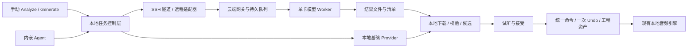

# 本地 DAW＋AutoDL：MIR 升级与音乐生成方案

## 2026-11-06 实施进度与容量复核

下方“未实施”是最初提案的历史状态。当前 ACE-Step 1.5 已在云端部署并通过 DAW/Agent 真实整链，完整模型备份已落 E 盘；MIR 仍由本机执行。用户本次授权并行部署其他模型，先安装云端 HTDemucs 四/六轨、Basic Pitch、Beat This 的文件和独立环境，不重启现有 ACE。文件/依赖就绪、GPU 推理通过、DAW 可选云端是三个独立验收项，不能互相替代。阶段记录见 [云端 MIR 准备](../2026-11-06-cloud-mir-stage/PLAN.md)。

云盘实测总计 268,435,456,000 B（250 GiB），可用 208,089,600,000 B（208.09 GB / 193.80 GiB）。以下 GB 均为十进制；大小按选定版本的官方文件元数据或本地注册文件核对，具体版本、文件和来源见 [CAPACITY-20261106.json](CAPACITY-20261106.json)，本次查询没有下载新权重。

| 尚待云端部署的权重 | 大小 GB | 范围 |
|---|---:|---|
| HTDemucs 四轨＋六轨 | 0.139 | 已在本机安装，云端需一份 |
| Basic Pitch ONNX＋Beat This | 0.081 | 不包含依赖环境 |
| SCNet XL IHF＋TransKun V2＋ChordMini BTC | 0.306 | 各选一个 checkpoint |
| YuE2 3B＋所需 VAE | 7.792 | 不含旧版 decoder、示例音频 |
| MuScriptor medium＋large | 6.694 | 为对比计入两版；实际下载需接受模型访问条件 |
| SheetSage2＋所需 MERT2 编码器 | 2.759 | 编码器使用配置指定 revision |
| **主计划合计** | **17.771** | 不含已经安装的 ACE 25.254 GB |
| 可选 Mel-Band RoFormer | 0.913 | 人声专项候选 |
| 可选 ACE XL Base 增量 | 19.953 | 复用既有兼容 LM/VAE/text，不重复下载 |
| **含可选项总计** | **38.637** | 不包含训练数据和额外模型版本 |

完整部署的额外空间预算为：权重 38.64 GB＋独立环境/缓存 60–90 GB＋下载安装临时空间 10–20 GB＋结果 30–40 GB，合计约 **139–189 GB**，按当前可用量还剩约 **19–69 GB**。只有权重大小是已核对的文件数值，环境和结果是保守预算。共享缓存与环境可能硬链接，不能把两处 `du` 简单相加。

结论：目前盘能容纳上述推理模型；不适合继续无限保留历史结果或再制作一份全量云端备份。后续按模型分批保存到 E 盘、校验后管理临时副本；此次计算不授权删除现有数据。磁盘放得下不表示 32GB 显存能同时加载全部模型，统一重任务队列及模型切换仍待实施。

## 最初方案（历史基线）

日期：2026-11-06。状态：**方案完成；部署、模型评测和 DAW 接入均未实施**。

本轮只检查现有代码、官方模型资料和 AutoDL 文档。没有租卡、安装依赖、下载权重、调用付费 API、执行推理或构建应用。当前可用候选仍为 0.11.0；不覆盖本地模型注册或旧版本。操作手册见 [AUTODL-RUNBOOK](AUTODL-RUNBOOK.md)。

## 1. 结论与范围

本地电脑负责创作、ASIO、录音、插件、工程与已完成音频的播放；AutoDL 负责需要 GPU 的离线分析和生成。GUI 与 Agent 调用同一任务接口。云端完成计算后，结果必须下载、校验并成为本地工程资产；云端关机不能影响已保存工程的正常使用。

第一阶段使用一个人、一台实例、一张 24–32GB NVIDIA GPU，一次一个重任务。先用预训练模型评测，不训练模型、不采购大型训练集。默认手动开关租用实例，DAW 负责连接状态和任务管理。新增任务历史用于断线重连，不是用户曾拒绝的工程自动保存/恢复。

## 2. 现状与需要新增的部分

| 能力 | 实际现状 | 本方案新增 |
|---|---|---|
| 分离 | HTDemucs 四/六轨，本地独立进程 | 远程 Provider；四轨与人声专项候选 |
| 转 MIDI | Basic Pitch ONNX CPU，有音高分析 | 钢琴专用、多乐器、鼓事件及必要的 CC 导入 |
| 和弦 | 自有 Chroma/模板/Viterbi，24 或 132 类＋N | 神经网络候选；和弦词表/转位的数据契约 |
| 节拍 | Beat This final0；BPM、首拍与固定比例 Warp | 保留模型；复用运行进程、结果缓存与远程选项 |
| 任务 | 每次新 Python 进程，最多 600 秒，一次一个重任务 | 持久任务服务、上传/下载、幂等、断线后查询 |
| 音乐生成 | 没有真实生成 Provider | ACE、YuE2 的独立适配与音频候选 |
| 工程接受 | 候选校验、一次提交、Undo、保存 | 复用边界，增加远程结果与生成类型 |

代码依据：`apps/desktop/EngineSessionAnalysis.inc` 的 `beginAnalysis`、ChildProcess 和录音/revision 检查；`scripts/audio_analysis/providers.py`、`beats.py`、`register.py`。当前 Agent 聊天模型不等于音频模型，不能靠更换 GPT/Kimi 自动获得这些能力。

已有短测中 Beat This 8 秒音频总进程耗时约 10.90 秒、tracking 约 0.50 秒，说明启动和加载值得先优化。测量条件为本机 i7-13700H、32GB、RTX3050 Laptop 4GB，Windows、worker 2 CPU 线程、文件缓存已热；这不是云端或整曲性能。原始依据见 [Beat 探针](../2026-11-05-tempo-warp/BEAT-PROBE.json)。

## 3. 部署资源与环境

- 起步评测建议 1×RTX4090 24GB，或同预算下 32GB NVIDIA 卡；先确保候选模型运行栈支持所选卡。32GB 的价值是显存余量，不能保证所有模型一起常驻。若选择 RTX5090，先逐个验证 PyTorch/CUDA/自定义算子，不直接复用现有本地 Torch2.5.1 环境。
- 建议实例分配至少 64GB 主机内存、8–16 vCPU；这是容量规划，不是所有模型的官方最低配置。云平台通常按每卡分配 CPU/RAM，租之前看具体实例。运行盘先预留约 200GB，模型族增加后按实际占用扩容；备份另计，不能把这当作已测磁盘需求。
- 首轮选普通非潮汐容器，手动开关机。以后确有自动开机需求再评估有生命周期 API 的 Pro；两种实例的磁盘规则不同。
- 普通 AutoDL 容器不支持在里面继续运行 Docker，第一版使用独立 venv/conda/uv 环境与受管理的 Python 进程；不以 docker-compose 为前提。[平台环境规则](https://www.autodl.com/docs/env/)
- `gateway`、`separation`、`beats`、`transkun`、`chordmini`、`ace`，后续 `muscriptor`、`sheetsage2`、`yue2` 分环境。每个环境固定 Python、上游 commit、依赖及权重 revision。只有证明兼容后才合并环境。
- 网关可长期运行，模型进程按需加载；连续同模型任务保持热加载。换重模型先卸载或退出旧 worker；只调用 CUDA empty_cache 不能当作已完全释放显存。CPU 内存也要有上限。
- 源码与轻量网关环境可在系统盘；大型环境在数据盘时必须单独备份或按锁文件重建，不能声称已进入系统镜像。

24GB 是评测起点，不是本文验证过的通用最低显存。短样本 batch=1 起步，先测正确性，再测长曲、峰值显存和质量参数；OOM 不自动改成另一种输出语义。

## 4. 模型升级顺序

所有新增模型当前都是候选。晋升默认模型须经过本项目数据、时延和使用范围验证，保留旧 Provider 作对照与显式本地基础选项。

| 阶段 / 任务 | 首选评测模型 | 定位与限制 | 来源 |
|---|---|---|---|
| 管线冒烟 / 四轨 | 现有 HTDemucs 迁到远端 | 先固定模型，定位传输/任务/导入问题 | [Demucs](https://github.com/facebookresearch/demucs) |
| 第一批 / 节拍 | 保留 Beat This final0 | 优先优化加载和缓存；本地短音频也可继续用；拍号/首拍保留人工修正 | [Beat This](https://github.com/CPJKU/beat_this) |
| 第一批 / 四轨 | SCNet XL IHF 对照 HTDemucs | vocals/drums/bass/other；不能代替六轨钢琴/吉他输出 | [权重与配置](https://github.com/ZFTurbo/Music-Source-Separation-Training/blob/main/docs/pretrained_models.md) |
| 第一批 / 钢琴 MIDI | TransKun V2 No Pedal Ext | 音符、力度、踏板；宿主需能保存并回放 CC64，不可悄悄丢弃 | [TransKun](https://github.com/Yujia-Yan/Transkun) |
| 第一批 / 和弦 | ChordMini BTC | 神经识别替换模板候选；仍不解决完整转位、9/11/13 扩展 | [ChordMini](https://github.com/ptnghia-j/ChordMini) |
| 第一批 / 生成 | ACE-Step 1.5 XL Turbo＋1.7B LM | batch1、先短片段；实测资源不够可登记独立 2B Turbo 档；先文字/歌词到音频 | [XL Turbo](https://huggingface.co/ACE-Step/acestep-v15-xl-turbo) / [GPU 指南](https://github.com/ace-step/ACE-Step-1.5/blob/main/docs/en/GPU_COMPATIBILITY.md) |
| 第二批 / 多乐器 MIDI | MuScriptor medium 与 large | 分乐器音符；不恢复真实力度，鼓主要为击打时刻；多乐器不等于每条独立原轨 | [MuScriptor](https://github.com/muscriptor/muscriptor) / [large 权重](https://huggingface.co/MuScriptor/muscriptor-large) |
| 第二批 / 综合乐谱分析 | SheetSage2 | 主旋律、和弦、节拍、调性和结构候选；不是完整多声部总谱 | [SheetSage2](https://huggingface.co/m-a-p/SheetSage2) |
| 第二批 / 歌曲生成 | YuE2 3B | 增加符号计划到歌曲音频；保存 ABC、语义中间结果及 WAV | [YuE2](https://github.com/multimodal-art-projection/YuE) / [硬件](https://github.com/multimodal-art-projection/YuE/blob/main/docs/hardware.md) |
| 后续 / 人声专项 | Mel-Band RoFormer Vocal | 单独比较人声/伴奏的保真和串音；不称通用多轨模型 | [发布者](https://github.com/KimberleyJensen/Mel-Band-Roformer-Vocal-Model) |
| 后续 / 生成式编辑 | ACE XL Base | extract/lego/complete 依具体模型任务矩阵开启；不把 Turbo 功能虚增 | [ACE 模型矩阵](https://github.com/ace-step/ACE-Step-1.5#-model-zoo) |

第一批也拆小提交：远端 HTDemucs 闭环 → ACE 最小生成 → TransKun/ChordMini → SCNet A/B。不等所有模型装好才做第一次 DAW 验收。

保留 HTDemucs 六轨，不用 SCNet 四轨覆盖它。MVSep Mega 53 Stems 可另做高级专项研究；输出语义重叠且不一定比专用模型好，不作为默认“53 轨重混”。主唱/和声、主音/节奏吉他是不同任务，不能用声部或乐器标签近似冒充。[发布说明](https://github.com/ZFTurbo/Music-Source-Separation-Training/releases/tag/v1.0.21)

ChordMini/SheetSage2 的公开能力仍不能保证复杂爵士 9/11/13、变化音与转位准确；模型词表没有的标签不靠更大的 GPU 补齐。先评估根音/性质/边界，再独立统计转位和扩展；不确定/词表外保留 unknown/unsupported 与原标签，N 只表示判断为“无和弦”，不能混用。不让语言模型把猜测写成“识别事实”。[SheetSage2 论文](https://arxiv.org/html/2610.05336v1)

## 5. 架构与数据管线

实现边界：

1. 本地任务层冻结 project/clip/asset ID、源文件 hash、选区、时间映射、BPM/拍号与 revision。音频文件处理和网络放在后台/独立 helper；实时回调不参与。
2. 只上传任务所需的音频片段或显式引用音频；模型需要时增加有界前后上下文，分别记录用户选区、实际上传范围、padding 与 offset，输出裁回选区。上传不是整个工程同步，不传 VST/Keyscape、API 密钥和无关文件。
3. 云端网关采用轻量 HTTP 服务、SQLite 任务记录、本地文件资产与一个 GPU 调度器。具体 FastAPI 等依赖在实施时锁定。各模型原有 API/CLI 由适配器包装，DAW 不直接依赖其私有端点。
4. 分析和生成使用共同任务基础设施，但保持不同能力与参数。现有 `start_analysis` 不塞入含糊的所有任务；新增生成入口和共享服务适配层，保持原 API 兼容。
5. 拟定网关接口：health、capabilities、上传/登记资产、提交任务、查询任务、取消、按 artifact ID 下载结果。所有路径是服务器控制的 ID，不接受模型提供的任意 shell/文件路径。
6. 状态：uploading → queued → loading → running → postprocessing → downloading → ready；失败、取消、interrupted、stale 各有明确定义。只有真实可计算进度才显示百分比，否则显示阶段。
7. 同一个 request_id 幂等；断线重试先查询旧 job_id，不重复计费或重复启动。断网而服务器仍开机时任务继续；服务器关机/进程崩溃不能假装 GPU 状态还在。恢复记录后标 interrupted，支持按已有有效阶段重跑，不能承诺任意模型续算。
8. 输出先写临时文件，完成后原子发布 manifest。下载同样校验 SHA-256、长度、采样率、声道、数值范围，再发布本地候选。
9. “接受”仍由工程命令一次提交，检查来源和 revision；工程已改动则提示重新定位/确认，不能把旧结果导入另一片段。防重复导入；Undo/Redo 引用的资产不能被缓存清理。
10. 已接受音频/MIDI/分析 JSON 进入本地工程资产，保存不能只存远程 URL。普通播放、工程保存和打开不要求租卡在线。

云端队列和本地结果缓存都是**拟新增**，当前 0.11.0 不支持上述远程服务。

## 6. 时基、格式与可编辑性

- 传输优先无损 WAV/FLAC。MIR 返回源音频秒/采样位置；保留 source sample rate、裁剪 offset、重采样与模型延迟补偿。不能在云端拿一个猜测 BPM 随意量化。
- 本地根据现有 sourceOffset、Warp 比例和工程位置映射。测试移位片段、裁剪片段、已有 Warp、半倍/双倍 BPM；结果要与声音重合。
- 分离轨保留声部角色、长度与偏移。不要分别做响度归一化后再宣称各轨求和等于原曲。
- 转 MIDI：结果包含 instrument、pitch、start、duration、velocity、CC/pedal（有则保留）。模型没有预测力度时，明确 default/inferred 来源；鼓为短触发事件，映射到可编辑 Drum Rack，不伪造其真实发声长度。
- MIDI 事件本身不携带 Keyscape 等音色。导入后需选本地乐器，鼓按明确映射加载；不上传用户商业音源。
- 当前严格和弦词表和 MIDI 导入能力要扩展并回归后才能接新模型。和弦结构应允许 root、quality、bass、extensions、原标签和 unsupported/unknown，不静默降为大/小三和弦。
- SheetSage2 先导出旋律 MIDI 和和弦/结构；五线谱排版与同步走带另一个功能，不把模型输出等同于已实现谱面编辑器。
- 生成先保留原始 WAV，实际检测长度/BPM/首拍。提示的“120 BPM、8 小节”不是精确采样契约；是否裁剪/Warp 对齐是随后可撤销的操作。
- ACE 的合成音频和后续分离结果记录为 generated/derived；不能作为还原录音的分析真值。YuE2 的符号计划可以成为候选 MIDI，但不是生成音频每个乐器的逐音转录。

## 7. 缓存、性能与费用

缓存键至少包括：输入内容 hash、裁剪范围/预处理版本、provider/model/weights revision、参数、seed、输出契约版本。推理缓存与工程应用映射分离：相同音频计算可复用，但导入位置/revision 每次重新检查。生成的“再生成”使用新 seed/request；同 seed 也不保证跨 GPU/软件版本字节一致，所以保存原始输出最可靠。

网关常驻不等于所有模型常驻；一张卡默认重任务并发 1，按当前任务族连续处理，避免不断加载卸载。轻量解码/上传可有界并行，但不阻塞本地录音线程。短片段在本地可能比上传云端更快，实际计时后再制定“自动”策略，不只比较 GPU 推理时间。

首轮预算可设为约 300–500 元的测试上限建议，实际按小时单价、运行时长、存储、传输及外部 API 单独记账；本轮没有开销。实例关机与关闭 SSH/DAW 是不同动作，后两者不会自动停止 GPU 计费。具体价格和保留期以租用时控制台为准。

自动关机以后可作为显式 opt-in：无活跃任务、无待下载唯一结果、备份完成后触发；第一版不让 Agent 自行租更多卡或无限重试。录音中先保留现有分析/导入限制，通过实际 ASIO 共存测试后再逐项放开。

## 8. 用户界面与 Agent

沿用 0.11.0 已批准风格，避免加入模型调试面板。普通用户看到任务、选区、基础/高质量、运行、取消、试听、添加轨道。高级菜单才显示具体模型。Settings 增加 AI Compute：本地/远程、连接测试、就绪状态、已登记模型、任务/磁盘限额；技术日志留开发档案。

Agent 通过 capabilities 得知真实支持的任务、输出类型、可用模型和限制；云端离线/许可未满足/模型未安装不可说已能执行。GUI 和 Agent 复用上传、候选、接受、Undo；进度轮询不重复请求聊天模型。语言模型 API 可以继续使用原有配置，与租卡计算服务密钥分开。

典型流程：“把这个片段分轨，把钢琴转 MIDI，识别和弦” → 固定选择与范围 → 选择明确支持 piano 输出的六轨 Provider → 钢琴输出完成后进入 TransKun → 和弦按指定源/预处理独立分析 → 本地试听、查看候选 → 接受导入。SCNet/HTDemucs 四轨不具备独立钢琴输出；能力不足时需改选现有六轨或独立钢琴素材，不能把 other 默认当钢琴。原混音和去鼓/人声的和声源哪个更好，应 A/B 实测，不能假定分离后总能提高和弦准确率。

“生成一段 8 小节音乐” → 读取明确 BPM/拍号/起点 → 把音乐描述/歌词发给 ACE 或 YuE2 → 收到原始音频 → 检查实际时长/拍点 → 试听 → 必要时单独对齐 → 接受为新音轨。未经用户选择不覆盖原轨。

## 9. 评测与晋升门槛

先准备约 20 个 15–30 秒短样本和 5 个 2–5 分钟长样本，这是筛选集，不是训练集或统计上充分的质量证明。覆盖钢琴、贝斯、吉他、人声/和声、鼓、爵士扩展与转位、流行/电子；有授权的真值素材用于指标，用户工程用于实际听感。保留一部分不参与调参的验收样本，记录训练集重叠风险。

| 检查 | 证据 |
|---|---|
| 推理有效 | 非空且可解码，声道/采样率/时长、NaN/Inf、边界/音高检查 |
| 分离 | 有真值时 SI-SDR/SDR；盲听串音、瞬态、相位和修正成本；四/六轨分开比 |
| MIDI | 有标注时 onset/offset F1，钢琴力度/踏板另测；分乐器统计，不能只报总音符数 |
| 和弦 | duration-weighted 根音/三和弦/七和弦/转位分项；词表外比例、边界误差和人工修改时间 |
| 节拍 | 拍点/强拍 F1、首拍和 BPM 倍频错误；不以一个 BPM 数字代表对齐正确 |
| 生成 | 条件遵循、歌词可懂度、结构、噪声/削波、可剪辑性、人工盲听与修整时间 |
| 速度 | 上传、排队、加载、推理、后处理、下载、落轨分开计时；冷/热运行；GPU/RAM 峰值 |
| 故障 | 断网重连、取消、重试不重复、磁盘满、坏文件、OOM、进程崩溃、实例关闭 |
| 工程 | GUI/Agent 等价、来源过期拒绝、一次 Undo/Redo、保存重开、云端离线仍可用 |
| DAW 性能 | 同一工程播放/录音时的真实采样率、实际缓冲区、负载、xrun/回调/交互数据，听感人工 |

使用相同 GPU 和输入、各模型已固定并记录的兼容依赖、可比较的质量档进行 A/B；不为强行相同 Torch 破坏兼容性。单例不报告 P95，重复次数足够才给分位数。各阶段原始请求、stdout/stderr、结果、metrics 与人工记录保存，不只保留“最快”一次。新模型必须在目标任务明显更好或节省修改时间才晋升；效果不够可继续留实验入口。

## 10. 实施顺序与完成条件

| 批次 | 工作 | 完成条件 |
|---|---|---|
| H0 | 基线保护、部署目录、环境/模型清单、固定样本、备份/恢复说明 | 新实例可凭清单重新运行，原 0.11.0/本地 Provider 不变 |
| H1 | 网关、单 GPU 队列、SSH、上传下载、远程 HTDemucs | 一条真实源片段→云端→本地候选→落轨→保存重开；断线不重复任务 |
| H2 | ACE 最小生成、TransKun、ChordMini、SCNet 对照，GUI/Agent 同步 | 每个能力真实样本通过；CC/和弦契约不丢信息；旧模型可选 |
| H3 | MuScriptor、SheetSage2、YuE2；逐个加载 | 多乐器/符号计划/歌词生成各自正确入轨，不虚增支持范围 |
| H4 | 长曲、缓存、故障恢复、播放共存、跨实例恢复演练 | 关云服务器仍能编辑播放；换实例能重跑固定样本；记录真实性能 |
| 后续 | 人声专项、更多分轨、ACE Base 生成式编辑、精细谱面 | 依据评测价值独立排期，不混入第一批 |

H0–H1 预计 2–4 个工作日，H2 再 3–5 日，H3 再 3–5 日，H4 再 2–4 日；合理预留约 2–4 周迭代。属于开发工作量估计，模型访问、下载、兼容性和人工测试会影响日历时间。“网页生成一段音频”可更早完成，不能代表上述集成完成。

代码管理：实施时另建功能分支，按任务基础设施、Provider、宿主导入、UI/Agent、测试分提交；各次构建继续走现有 Recorder，原始日志进 build-logs，摘要进 docs/builds，DEVLOG 只追加。公开 Git 保存代码/锁文件/无秘密 manifest/脱敏评测摘要；模型和音乐大文件位于仓库外，不混入版本管理。

## 11. 模型许可与来源登记

每个模型分开记录 code license、weights license、依赖许可与用途，不以“开源”替代全部授权。记录取得时间、固定 revision 和当时许可快照；公开介绍链接不是已锁定的下载版本。

- ACE XL Turbo 模型卡标 MIT，是优先评测生成入口；仍需核对实际所装 LM/codec 等组件。[模型卡](https://huggingface.co/ACE-Step/acestep-v15-xl-turbo)
- MuScriptor 和 SheetSage2 权重为 CC-BY-NC4.0，部分下载需接受访问条款。个人非商业评测与以后面向客户提供推理服务/随 DAW 分发权重分别处理。[MuScriptor](https://huggingface.co/MuScriptor/muscriptor-large) / [SheetSage2](https://huggingface.co/m-a-p/SheetSage2)
- 更正此前笼统说法：YuE2 权重为 CC-BY-NC，并额外允许个人音乐人/创作者免费使用模型并商业化其生成物；公司商业模型使用和商业转售权重不在此额外许可内。不能说“所有 YuE2 生成物都不能商用”。[官方模型许可](https://github.com/multimodal-art-projection/YuE/blob/main/MODEL_LICENSE)
- MSST 的具体 SCNet 权重来自其发布者；ChordMini、Demucs 等需要分别保存代码和实际权重的许可证据。暂未确定的权重使用范围登记为待核对，不预装进公开发行包。

需要训练/微调时再单列数据与算力计划。当前阻力主要是模型选择、输出契约、可恢复服务与质量验证，单纯多租 GPU 不会补齐未预测的音乐信息。
