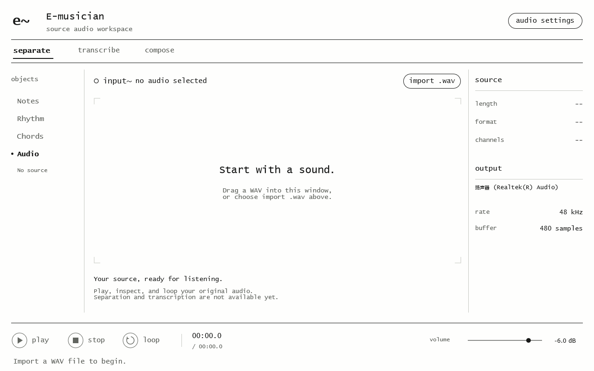
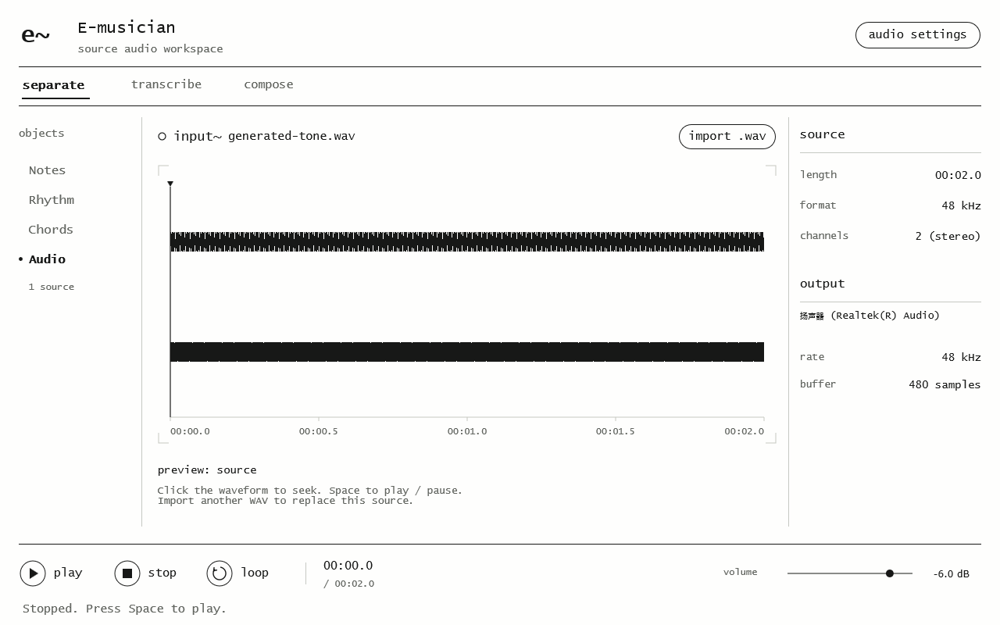
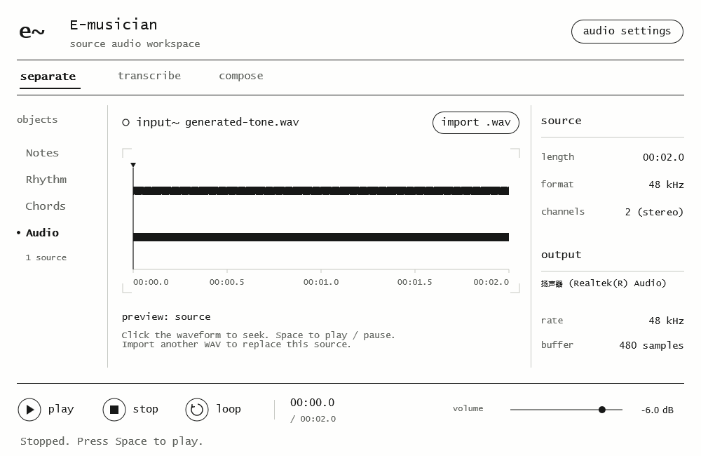

# M1 首轮原生原型验证

日期：2026-10-26，Asia/Shanghai。版本：应用 0.1.0，开发计划 0.3。范围是单源 WAV 试听基础，不是完整 DAW 或 M1 全部验收。

## 配置与构建

- Windows 11 10.0.26200，i7-13700H；VS 2026/MSVC 19.50，SDK 10.0.26100.0，CMake 4.2.3，Python 3.14。
- C++20，固定 Tracktion/JUCE 提交见 [依赖记录](../../DEPENDENCIES.md)。本轮无源码 Git 提交，使用构建 JSON 的源码文件 SHA-256 记录输入。
- Debug [构建通过](../../builds/20261026T063652.048149Z-81f6bbb6a9.json)；Release [构建通过](../../builds/20261026T064047.266434Z-32d957ff80.json)。Release 命令开始/结束源码未变化。
- 首次编译的命名空间错误已修复；[失败记录](../../builds/20261026T061630.730815Z-529c08f40c.json) 保留。

## 检查结果

| 项目 | 结果 | 范围 |
|---|---|---|
| development.logging | 3 项 Python 测试通过 | 真实命令失败、启动失败、日志持久化、字节保存、源码变化、重定向编码 |
| core.contracts | 84/84 断言通过 | 固定 BPM 时间换算、无效值/溢出、版本/工程/重复请求检查 |
| engine.integration_smoke | 通过 | 真实 WAV 导入、过期/无效导入保留素材、定位/停止/循环状态、实际 Tracktion 渲染、原生组件截图 |
| 短时设备 Transport | 通过 | Space 播放、暂停保持、续播、源结束停止、循环回绕、停止归零 |
| 已打开 GUI 与独立测试共存 | 通过 | Release 交互窗口开启时，Debug 独立进程仍产出新的报告与截图 |

Release [CTest 记录](../../builds/20261026T064336.196257Z-3f1105d023.json) 为 3/3 组通过。最终 Debug [CTest 记录](../../builds/20261026T064628.184512Z-477995a2e6.json) 同为 3/3。CTest 分组数与内部断言数分别记录，不混算。

音频来自测试代码生成的双声道正弦，未使用用户音乐。渲染为 48 kHz、24-bit、96000 samples（2 秒）；-6/-12 dB RMS 为 0.07087857 / 0.03552344，比例约 0.50119。见原样复制的 [引擎报告](engine-report.json)。

短时 Transport 检查观察到扬声器 Realtek(R) Audio，48 kHz、480 samples，以 -60 dB 增益运行。见 [Transport 报告](transport-report.json)。**这不是物理回环、听感或性能测量。** 没有测量欠载、CPU 分位数、端到端延迟或 30 分钟稳定性。

## 界面与启动

组件截图来自实际 Release 原生控件树，未使用 HTML 或设计图模拟。空状态及两个尺寸经过查看；未发现明显文字重叠/裁切。100%、150%、200% 系统 DPI 和完整鼠标/文件对话框流程待实机验收。

Release 交互程序通过 [启动命令](../../builds/20261026T064622.712628Z-e2b5cbdb72.json) 打开。随后独立读取进程信息，PID 50380，响应正常，窗口标题为 `E-musician - Audio workspace`。这是一轮启动观察，不是长期稳定性测试。

## 未完成与下一轮

人工听感、系统 DPI、官方示例、录音/VST3 风险检查仍待完成。下一轮补齐 M1 控制协议和实机验证，再做多轨、保存、恢复与编辑。当前没有模型分离、转录、Compose 编辑、Agent 或用户导出界面。
